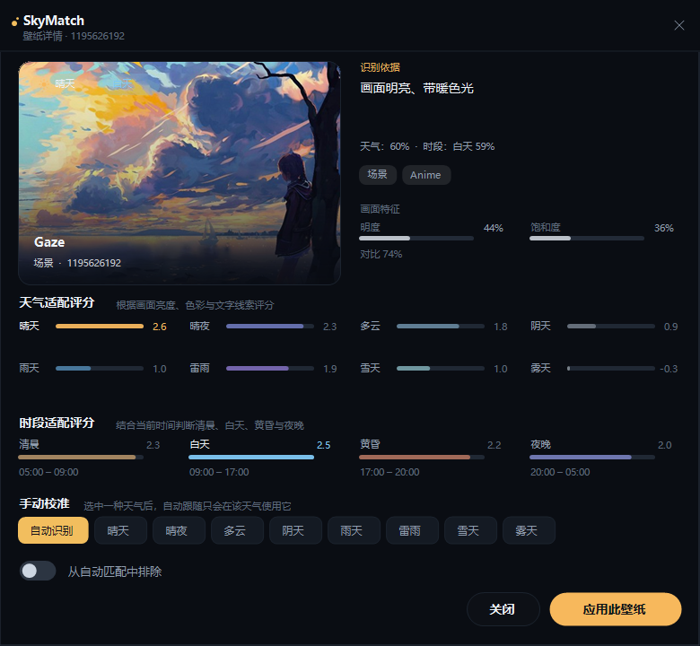

# Changelog

> 本文件保留项目的详细功能演进与历史说明。最新功能请看 [README](README.md)。

# 变更历史

一个给 Windows 桌面用的小工具：**读取你所在位置的实时天气与区县，结合当前时段，从本地壁纸或创意工坊订阅榜中挑出合适的一张，并随天气/时间自动更换。**


## 启动方式

直接双击程序目录里的：

- [启动 SkyMatch.lnk](<启动 SkyMatch.lnk>)（推荐，带应用图标）
- [启动 SkyMatch.bat](<启动 SkyMatch.bat>)（如果快捷方式被移动或失效）

两者都会启动 `dist\SkyMatch.exe`，不需要进入 `dist` 目录。请保持 `dist` 文件夹与启动器在同一个 `sky-match` 目录下。

## 功能

- **定位到市/区**：启动后通过 IP 获取大致位置，再用经纬度反查区县；也可以搜索城市手动修正，界面显示“南京市 · 鼓楼区”。
- **时段感知**：自动判断清晨、白天、黄昏、夜晚，把「天气评分 + 时段评分」一起用于推荐和自动切换。
- **只读取你真正订阅的壁纸**：扫描 Steam 创意工坊 `431960` 目录，自动排除特效、音频可视化、鼠标粒子、时钟等资产项目，以及没有 `project.json` 的杂项目录。
- **自动排除不适合的项目**：标题/标签/描述中的头像、Profile、手机竖屏、Logo、纯文字、测试/模板等会被排除；默认开启「风景优先」，人物特写不会进入工坊候选和自动推荐，可在工坊页手动关闭；游戏/系列名在识别天气时会被忽略，避免“奥德赛 暮光信条”这类标题误导。
- **年龄分级**：设置页可独立勾选「全年龄 / 青少年 / 成人」，支持任意两档或三档组合；工坊和壁纸库只显示被勾选的分级，本地读取 Wallpaper Engine 的 `contentrating`，工坊读取 Everyone/Questionable/Mature 标签。
- **订阅榜工坊补充**：默认开启且不显示开关。风景优先开时，为未屏蔽的 9 个 Steam 内容标签各保留前 100 张；风景优先关时，为 25 个 Steam 内容标签各保留前 50 张。两种模式都合并去重，按 `subscriptions` 排序但隐藏名次。
- **自适应窗口**：可拖动窗口边缘调整大小或最大化；壁纸库窗口模式固定 3 列、最大化固定 5 列纵向滚动，卡片最大宽度受限并整体居中，避免拉宽变形；工坊网格随宽度增加列数，全屏时天气总览会扩展到未来 24 小时和 7 天预报。
- **订阅后自动入库**：在 Steam 里订阅并下载壁纸后，运行中的软件会在数秒内检测到并刷新壁纸库，无需关闭重启。
- **工坊网格视图**：默认 4 张一排，鼠标悬停显示放大预览、订阅人数、天气/时段和安装状态；也保留列表视图。
- **随天气/时段切换**：优先选择“专属分类”；没有专属壁纸时，选择最接近的风格，并在界面明确标注「近似推荐」。
- **可手动校准**：在壁纸详情里把任意一张壁纸锁定到某个天气，或从自动匹配中排除；设置页可一键重置。
- **壁纸音量**：左侧音量卡片通过 Windows 音频会话直接调节 Wallpaper Engine 进程的音量，支持静音，拖动时实时生效，不影响系统其他声音。
- **不破坏原桌面**：第一次扫描时保存原始壁纸，可随时恢复；切换通过 Wallpaper Engine 官方命令行完成。
- **托盘常驻**：关闭窗口后留在系统托盘，后台继续跟随；支持开机启动和切换通知。





## 快速开始

1. 启动 Steam 和 **Wallpaper Engine**（需要已安装，并订阅了至少一张壁纸）。
2. 双击运行：

   ```
   dist\SkyMatch.exe
   ```

3. 首次启动会自动定位、扫描壁纸，并应用当前天气 + 时段的匹配壁纸；之后每次启动也会先检查当前最合适的壁纸并切换。天气每小时刷新一次，时段变化会实时检查，天气类别或时段变化时自动切换。
4. 想暂停自动切换时，关闭左侧「自动跟随」开关；想恢复原壁纸，在设置页点击「恢复最初壁纸」。

> 创意工坊订阅榜需要访问 `steamcommunity.com`。程序使用浏览器请求头，并依次尝试英文 + 美国商店线路、英文线路和默认线路，不再依赖香港 IP；如果所有线路都超时，再检查网络或 Steam 社区加速。

不需要安装 Python、Node.js 或其他运行库。程序是单文件 `.exe`，依赖系统自带的 **.NET Framework 4.8**。

## 使用说明

### 天气总览

- 左侧大卡片以当前天气类型的代表壁纸打底，显示温度、体感、湿度、风速、降雨概率、云量、降水量、日出日落和定位区县。
- 右侧「此刻推荐」使用更大的壁纸画面，优先读取原始预览分辨率，并用完整画面 + 虚化背景展示。
- 下方逐小时预报会以当前整点为起点，只显示接下来的小时；页面每 30 秒按当前时间重新计算，不会停留在抓取时的固定画面。
- 未来预报和每种天气类型带代表壁纸预览的天气图谱；本地没有对应类型时自动使用工坊同类型预览。
- 窗口模式下未来 8 天采用 4×2 排列，标题和说明同步显示；全屏模式保持原来的 7 天/宽屏布局，不被窗口排版影响。
- 全屏宽屏时最多显示 24 小时和 7 天，天气图谱和未来 7 天按比例分配宽度；点击天气分布中的分类会跳转到对应筛选。

### 壁纸库

- 顶部按天气筛选，右侧搜索标题、标签和描述。
- 每张卡片显示自动识别出的天气、时段、置信度和识别依据；标题栏会显示“自动排除 N 张”。
- 自动排除的头像/手机竖屏/文字图/测试图不会进入推荐池，但仍可在设置里恢复手动排除的壁纸。
- 点击卡片打开详情，可：
  - 查看 8 类天气和 4 个时段的完整评分；
  - 把壁纸锁定到某个天气（自动跟随只在该天气使用它）；
  - 恢复自动识别；
  - 从自动匹配中排除；
  - 立即应用这张壁纸。

### 创意工坊精选


- 默认开启且不显示参与开关。首次启动会为 9 个未屏蔽 Steam 内容标签各抓取前 100 张并合并去重；标签抓取采用 3 路并发，首屏先补 40 张预览，其余预览后台继续。
- 抓取完成后如果某种天气类型少于 10 张，会从已抓取的候选中按该天气得分补足到 10 张，避免天气分类出现空档。
- 工坊固定按 `subscriptions` 不重复订阅人数排序；订阅排名、名次徽章、「订阅榜最高」和投票数均已隐藏。
- 顶部「风景优先：开」会额外运行人物检测，过滤所有检测到人物的壁纸（包括远景小人），并屏蔽以下标签：游戏、动漫、卡通、女性、男性、中世纪、网红事物、MMD、音乐、科幻、运动、科技、电视节目、汽车、3D、未指定样式。
- 「风景优先：关」会取消标签屏蔽，改为 25 个 Steam 内容标签各保留前 50 张并合并去重；人物过滤也取消。
- 工坊候选和天气选择会过滤纯黑、纯灰及任何单一颜色块的预览；工坊中直接隐藏，本地已下载的壁纸仍显示在壁纸库但不会参与天气匹配。
- 默认 4 张一排的网格视图，鼠标悬停显示放大预览和详情；点「列表视图」可切回列表。合并后的全部候选会预下载预览图，旧缓存缺图在启动后台自动补齐。
- Steam SSR 的部分 `preview_url` 只有 UGC 目录、没有尺寸参数，直接访问会返回 502；程序会依次尝试 637×358、1024×1024、5000×5000 的 CDN 尺寸，取第一个可用版本，已缓存的旧 URL 也会在补齐时修正。
- 设置页「识图算法」旁新增「重新计算匹配度」按钮，只有手动点击或重新抓取工坊时才重算全部壁纸，启动不再自动重算。
- 启动时先显示首页，天气网络刷新、缩略图和其他页面在后台继续加载；首页壁纸使用已缓存的匹配结果，避免先显示渐变再换成另一张。
- 工坊标题右侧的箭头可展开/收起副标题与状态小字；收起时只保留标题、箭头、标签和卡片。
- 设置页「识图算法」下方的箭头可展开除 CLIP 外的全部过滤算法说明：单色块、YOLO 人物检测、Steam 标签屏蔽、年龄分级、不适配预览、天气保底和手动校准优先级。
- 工坊天气标签在窄窗口自动换行，分页按钮下移，避免标签文字或最后一个标签被截断。
- 壁纸库中的工坊补充卡与工坊精选使用同一套卡片、悬停大图、屏蔽按钮和点击应用/订阅行为；本地与工坊之间使用高对比卡片条、黄色标记和底线分隔。
- 本机已订阅/下载的壁纸会自动进入隐藏白名单并默认显示在壁纸库，不受 Steam 标签、风景优先或人物过滤影响；仍然遵守手动屏蔽、手动排除和年龄分级。
- 工坊翻页后自动把网格/列表滚回顶部，下一页从第一张开始浏览。
- 壁纸库不受工坊翻页逻辑影响：每个天气标签单独记住自己的滚动位置；切换标签时先清空旧滚动范围，再按新标签内容高度重新计算滚轮范围；搜索或后台刷新时保持当前位置，不自动回到顶部。
- 启动时只创建首页；壁纸库、工坊和设置页首次进入时才构建，避免打开软件时一次性创建大量隐藏控件。本地壁纸的完整识图会延后 5 秒并以低线程优先级运行，避免抢占首屏。
- 壁纸库切换天气标签时按新标签内容重新计算滚动范围；工坊翻页则自动回到顶部，两套行为互不影响。
- 壁纸库和工坊的悬停详情面板改为按卡片四周实际空间选边：优先放在卡片右侧，右侧不够放左侧，两侧都窄时放到卡片上方/下方，不再按列号猜测，避免最左侧卡片详情被挤到左边。
- 已安装的候选可以点「应用」，未安装的点「订阅」打开 Steam 工坊页面；订阅并下载后，软件会自动检测到新壁纸，无需重启。
- 抓取过程中每完成一页就立即追加到列表，预览图、缓存和最终排序在后台继续；重新抓取时无需盯着空页面等待。
- 抓取期间已经出现的候选可以直接应用/订阅；也可以切换页面、列表/网格、排序或风景优先，不会中断后台抓取。
- 窗口可拖动边缘调整大小，也可用标题栏最大化按钮；工坊网格会在 3–8 列之间随宽度变化。
- 数据缓存 12 小时；点「重新抓取」可强制更新。Steam 原生不支持第三方软件代替用户点击订阅，所以「订阅」会打开 Steam 页面，下载完成后的入库是自动的。

### 音量与设置

- 左侧「桌面音量」滑块直接调节 Wallpaper Engine 进程的声音，点击喇叭图标可静音；不影响系统其他应用。
- **位置与天气**：自动 IP 定位，或搜索城市（支持中文、英文城市名）；搜索框会显示最近 8 个选过的城市，可直接点击切换；右上角「锁定定位」开关会忽略后续 IP 定位变化，手动搜索仍可修改位置。
- **自动跟随**：开关、是否结合当前时段、天气每小时刷新、开机启动、关闭到托盘、切换通知；首页右上角提供「自动更换壁纸」开关和「每隔 __ 分钟自动更换」行内输入，开关关闭时输入区隐藏，打开后渐入；首页还显示每秒更新的当前时间。
- **全屏保护**：检测到游戏/视频等全屏程序时暂停自动切换壁纸，退出全屏后由定时器恢复检查；手动点击切换不受限制。
- **只切不匹配的壁纸**：自动跟随时，如果当前桌面壁纸已经匹配当前天气和时段，不再为了换“更高分”的壁纸而重新加载 Wallpaper Engine。
- **外部切换同步**：在 Wallpaper Engine 中手动切换壁纸后，软件每 5 秒读取当前活动壁纸并刷新「使用中」状态，不需要重启 SkyMatch。
- **内容分级**：全年龄 / 青少年 / 成人三个独立开关，可任选一档、两档组合或全部；工坊和壁纸库只显示勾选的分级，至少保留一档。本地读取 `contentrating`，工坊读取分级标签。
- **Wallpaper Engine**：显示安装路径、运行状态、壁纸数量和恢复原始壁纸。
- **数据与维护**：打开配置目录、重置手动校准、恢复被排除的壁纸。

### 智能识图算法

识图固定使用 **CLIP ViT-L/14**，不再提供快速/低精度算法切换：

- 本地壁纸和工坊抓取到的全部壁纸，都会用同一个 L/14 模型重新计算天气、时段和主人物/主风景，不再只算前几百张。
- 首次全量计算会下载全部工坊预览并在后台逐张推理；结果写入 `%LOCALAPPDATA%\SkyMatch\vision-cache.json`，下次启动直接复用，只补算新增或预览发生变化的壁纸。
- 天气输出 8 类、时段输出 4 类；匹配排序使用这些概率和置信度。
- 主人物/主风景通过“人物特写 vs 宽景/远景小人”的提示词组判断。
- 风景优先开启时，额外用 YOLO 人物检测扫描预览中的所有人（包括远景小人），检测到人物的壁纸不进入风景候选。
- 模型离线运行，不需要联网，也不会上传壁纸。
- 模型文件位于 `dist\models\clip-large` 和 `dist\models\yolo`，L/14 首次加载约需 700–800 MB 内存。
- 模型与推理来源：[openai/CLIP](https://github.com/openai/CLIP)、[Xenova CLIP ViT-L/14 ONNX](https://huggingface.co/Xenova/clip-vit-large-patch14)、[ONNX Runtime](https://github.com/microsoft/onnxruntime)、[Ultralytics YOLOv8](https://github.com/ultralytics/ultralytics)。

## 匹配逻辑

天气分类与壁纸分类是一一对应的 8 个类别：

| 天气 | 识别参考 |
| --- | --- |
| 晴天 | 高亮、暖色、阳光或“晴/日落/夕阳”等文字 |
| 晴夜 | 深色画面、冷色高光、月亮/星空/霓虹/夜景等文字 |
| 多云 | 中等亮度、柔和低饱和、云层/天空等文字 |
| 阴天 | 灰蓝、低饱和、偏暗的画面 |
| 雨天 | 冷蓝灰影调、雨/rain/潮湿等文字 |
| 雷雨 | 高对比暗色、强烈色光、雷/storm 等文字 |
| 雪天 | 明亮、冷白、低饱和、雪/snow/winter 等文字 |
| 雾天 | 低对比、朦胧灰调、雾/fog/mist 等文字 |

匹配时：

1. 先按当前天气和当前时段分别打分，再相加；两者都匹配的壁纸优先级最高；
2. 优先选择“主分类”正好等于当前天气/时段的壁纸；
3. 如果没有专属匹配，就按评分选择最接近的风格，并在界面上标注「近似推荐」；
4. 手动锁定的壁纸拥有最高优先级，只会在锁定的天气出现；
5. 标题里的游戏/系列名（如“奥德赛 / Odyssey / 暮光信条 / Assassin's Creed”）在天气识别前会被忽略，避免游戏名里的“夜/暮光”误导；
6. 头像、Profile、手机竖屏、Logo、纯文字、测试/模板等不适合作为桌面壁纸的项目会被自动排除；
7. 默认开启「风景优先」：人物特写会被过滤，避免工坊订阅榜前排全是人物；可在工坊页关闭；
8. 被排除的壁纸不会进入推荐池。

CLIP 识别不保证 100% 符合你的主观感受；详情页的手动校准就是为这种情况准备的。

## 自动切换与订阅入库

- 第一次启动：天气取到后，自动应用当前匹配。
- **每次启动都会检查一次当前最合适的壁纸**；如果与当前桌面壁纸不同，会立即切换，不会等到下一次天气/时段变化。
- 之后：每小时获取一次所选地址的最新天气，并持续检查时段边界；只有**天气类别或时段变化**时才评估是否切换。当前壁纸仍然最匹配时不会重复切换。
- 软件运行期间每 5 秒检查一次工坊目录；在 Steam 里订阅/下载新壁纸后，壁纸库会在几秒内自动刷新，不需要关闭软件重启。
- 应用前会先在后台启动 Wallpaper Engine（如果它没在运行），再通过官方命令：

  ```
  wallpaper64.exe -control openWallpaper -file "<project.json 或视频文件>" -monitor 0
  ```

- 壁纸音量通过 Windows 音频会话调整 Wallpaper Engine 进程，不修改系统总音量；切换壁纸后会重新应用保存的音量/静音状态。
- 目前只控制 **第一个显示器（Monitor0）**。
- 所有设置、手动校准和音量保存在本机：

  ```
  %LOCALAPPDATA%\SkyMatch\settings.json
  ```

## 构建

需要 Windows 自带的 .NET Framework 4.8 和 `csc.exe`，不需要额外 SDK。

```bat
build.cmd
```

产物：

```
dist\SkyMatch.exe
dist\SkyMatch.exe.config
dist\*.dll                 ONNX Runtime 及 .NET 依赖
dist\models\clip-large     CLIP ViT-L/14
dist\models\yolo           YOLOv8n 人物检测
```

也可以使用 PowerShell：

```powershell
powershell -NoProfile -ExecutionPolicy Bypass -File .\build.ps1
```

## 命令行/诊断

```text
SkyMatch.exe --minimized              启动后直接隐藏到托盘
SkyMatch.exe --diagnose [输出路径]     扫描壁纸、分类并请求一次天气，写出 JSON 报告
SkyMatch.exe --page 1                 启动时打开壁纸库（0=总览，1=壁纸库，2=工坊，3=设置）
SkyMatch.exe --detail <workshopId>    启动时打开指定壁纸详情
SkyMatch.exe --page 4                 启动时打开城市搜索（开发诊断）
```

诊断报告默认写到 `%LOCALAPPDATA%\SkyMatch\diagnostic.json`。

## 目录结构

```
sky-match/
├─ src/                   C# 源码
│  ├─ Services/           天气、扫描、识别、Wallpaper Engine 控制
│  └─ UI/                 窗口、页面和自绘控件
├─ assets/                应用图标
├─ lib/                   ONNX Runtime、.NET 4.8 参考程序集
├─ models/                CLIP 模型与预计算提示词向量
├─ docs/                  界面截图
├─ tools/make-icon.ps1    重新生成图标
├─ build.ps1 / build.cmd  构建脚本
└─ dist/                  可直接运行的产物（约 316 MB）
```

## 隐私与限制

- 定位时会把公网 IP 发送给 IP 地理定位服务；手动搜索城市时会把城市名发送给 Open-Meteo，并用坐标向 BigDataCloud 反查区县。开启创意工坊订阅榜后，会读取 Steam 公开的创意工坊页面；除此之外不上传壁纸文件、桌面截图或 Wallpaper Engine 配置。
- IP 定位只能到城市级，区县是根据城市中心坐标反查的，不一定是你实际所在的小区；需要更精确时可以搜索城市修正（区县会随坐标更新）。
- 年龄分级只按 Wallpaper Engine 提供的分级标签/`contentrating` 过滤；未标注的项目按全年龄处理，且至少需要勾选一个分级。
- 天气来自 Open-Meteo，不需要 API Key；网络不可用时显示上次缓存。
- 创意工坊页面需要能访问 `steamcommunity.com`；直连失败时请开启 Steam 社区加速器。
- 未安装的工坊候选需要先在 Steam 中订阅并下载，才能应用或参与本地自动切换；第三方程序无法替用户完成 Steam 订阅点击。
- 音量只调整 Wallpaper Engine 进程的音频会话，不会修改系统总音量。
- IP 定位通常只到城市级，可能偏离你所在区；可以在设置里搜索城市修正。
- 壁纸识别固定使用本地 CLIP ViT-L/14 判断主人物/主风景、8 类天气和 4 个时段，仍可能受画风、遮挡和截图质量影响，可用详情页手动校准。
- 只有场景、视频和 Web 类型的壁纸会参与匹配；Wallpaper Engine 的 Asset/Effect 项目会被自动排除。视频壁纸文件超过 **10 MB** 时不会加入候选（本地扫描和工坊 SSR 的 `file_size` 都会检查）。
- 应用只在运行期间自动切换；关闭到托盘后仍在运行。

## 更新记录

### 1.2.0

- 定位在经纬度反查后显示到区县（如“南京市 · 鼓楼区”）。
- 工坊改为 9 个未屏蔽内容标签各保留前 100 张后合并去重；某天气不足 10 张时按天气得分补足。
- 新增 4 张一排的网格视图；鼠标悬停显示放大预览、订阅人数、天气/时段和安装状态，投票数已隐藏。
- 订阅或下载新壁纸后自动刷新壁纸库，无需关闭软件重启。
- 工坊抓取改为逐页显示：第一页返回后立即出现候选，预览图与缓存后补，不再等 20 页结束；Steam 访问使用浏览器请求头、英文/美国商店线路回退和会话 Cookie。
- 抓取期间保留切换页面、视图、排序、风景优先以及应用/订阅操作。
- 窗口支持拖动边缘调整大小和最大化，标题栏/窗口四角为圆角；壁纸库固定 3 列纵向排列，最大化/还原不会横向跳动；工坊列数随窗口宽度自动增加。
- 最大化时自动关闭整窗合成并强制重绘页面，减少全屏卡顿和局部透明。
- 全屏天气总览会扩展为 24 小时 + 7 天预报，避免把 12 小时/5 天卡片硬拉大。
- 窗口模式的未来预报改为 4×2 八天，标题/说明/Tile 尺寸按两行重新计算；全屏模式保持 7 天布局。
- 天气总览改为壁纸优先：当前天气卡片用代表壁纸打底，推荐卡放大到约 60% 宽，天气图谱每个分类显示代表壁纸（本地没有则用工坊预览）。
- 天气图谱与未来 7 天在全屏下按 52% / 48% 分配，避免图谱被压得过窄；今日详情增加云量、降水量等指标。
- 天气图谱左右箭头切换代表壁纸，点图打开放大详情。
- 工坊人物过滤加强：扩充角色/作品名单，并对 Anime、Cartoon、Game、Furry、Sports 等标签做硬过滤。
- 工坊精选增加 40 条/页分页和天气类型筛选；壁纸库类型少于 9 张时补充工坊同类型壁纸并显示分隔线，支持悬停大图与详情。
- 屏蔽列表卡片悬停不再显示详情；修复 Steam UGC 预览 URL 缺少尺寸参数导致的 502/缺图，按 637/1024/5000 多尺寸回退并在启动时补齐旧缓存缺图。
- 壁纸库的本地/工坊分隔线改为高对比卡片条 + 黄色标记；工坊上一页/下一页切换后自动回到顶部。
- 壁纸库每个天气标签独立保存滚动位置，切换时先清空旧滚动范围并按新内容重新计算滚轮上限；首页先启动，壁纸库/工坊/设置页延迟构建，本地完整识图延后 5 秒低优先级运行。
- 回退上一轮预览刷新改动；修复天气更新报「块的长度与它的补集不匹配」：不再启用 Deflate 自动解压，仅接受 GZip，避免 .NET DeflateStream 的 zlib 头冲突。
- Steam 访问适配浏览器请求头、会话 Cookie，并回退英文/美国商店线路；标签抓取 3 路并发，首屏预览优先，首次抓取明显加快且不再依赖香港 IP。
- 首页新增每秒更新的实时时钟（日期 + 时分秒）；所选地址的天气改为每小时刷新一次，缓存未满 1 小时不重复请求。
- 工坊抓取边下边显示并即时快速分类，全部结束后按不重复订阅人数最终排序；投票数从卡片、列表和悬停详情中隐藏。
- 位置搜索新增最近 8 个城市历史，打开搜索框即可点击切换；「位置与天气」右上角新增锁定定位开关，锁定后 IP 定位不会覆盖当前位置。
- 被屏蔽的壁纸同时从卡片和详情页移除；即使通过 `--detail` 指定 ID 也不会打开详情，取消屏蔽后才恢复。
- 屏蔽按钮悬停提示改为按文字实际宽度和高度自适应，单行完整显示「屏蔽后不会在工坊出现，可在设置中取消屏蔽」，不会再被截断或换行挤出。
- 工坊悬停卡片增加屏蔽按钮；设置页新增屏蔽列表，可取消屏蔽，重新抓取仍保持屏蔽。
- 屏蔽/取消屏蔽按钮增加渐入提示；设置页屏蔽列表改为带预览图的卡片网格，只显示「取消屏蔽」按钮，悬停不再弹出详情。
- 渐入提示框按圆角 Region 裁切，去掉四角多余像素。
- 全屏首页交换推荐卡与未来 7 天的尺寸：上排缩小、下排放大；左下壁纸图谱，右下此刻推荐；7 天预报逐日使用对应天气壁纸打底。
- 工坊启动即抓取，最多 1000 个候选；累计超过 500 个后自动放慢翻页速度，降低不稳定风险。
- 壁纸库刷新时关闭重绘并启用双缓冲，工坊补充卡片不再闪黑屏。
- 此刻推荐支持左右箭头切换同类型合适壁纸；应用/详情按钮作用于当前切换到的壁纸。
- 设置页可自定义工坊抓取间隔天数，并显示“距离下一次抓取壁纸还有 X 天”；倒计时到 0 当天自动抓取，可随时关闭「工坊倒计时自动抓取」改为手动抓取。
- 新增「每次打开软件自动抓取」开关：开启后每次启动都会强制重新抓取工坊，不受缓存和倒计时限制；关闭时仍按缓存/倒计时。
- 间隔天数使用无边框小输入框，数字居中，旁边是「保存」。
- 开启工坊后，默认启动时只在缓存不存在或倒计时到 0 时抓取；打开「每次打开软件自动抓取」后则每次启动都强制抓取。
- 壁纸库中的工坊补充卡改用与工坊精选相同的卡片、悬停大图、屏蔽按钮和点击应用/订阅行为。
- 风景优先打开的 Steam 标签屏蔽新增「3D」，可抓取的内容标签由 10 个变为 9 个，合并后目标总数 100 张。
- 工坊标题小字改为箭头折叠；设置页识图算法下方新增过滤算法展开箭头。
- 工坊参与开关默认隐藏并强制开启；风景优先开为 9 个未屏蔽标签各保留前 100，关为 25 个标签各保留前 50；订阅名次徽章全部隐藏。
- 壁纸库窗口模式 3 列、最大化 5 列；切回窗口时重新按 3 列排列，不横向移位、不出现第四列残影；全屏卡片限制最大宽度并居中。
- 工坊标签条在窄窗口自动换行，分页按钮下移，0 张壁纸的标签也能完整显示。
- 首次启动默认抓取 9 个内容标签各前 100 张并合并去重；之后按缓存、倒计时或「每次打开软件自动抓取」设置决定是否重抓。
- 启动不再自动重算匹配度：本地/工坊结果持久化复用，设置页新增「重新计算匹配度」按钮；启动先显示首页，目标 2–3 秒内可操作。
- 切换壁纸改为发送 Wallpaper Engine 命令后立即返回，不再等待控制进程退出或轮询配置；隐藏页面也不会在切换时重建卡片，避免 2–3 秒卡顿。
- 切换壁纸时壁纸库/工坊只重绘当前卡片，不再全量重建；首页只同步「已匹配/立即切换」按钮，不再重算整页推荐与图片。实时时钟只更新底部状态栏，不再每秒重绘天气大图。
- 新增全屏检测：全屏游戏/视频期间自动跟随和推荐轮换都不发切换命令；退出全屏后恢复检查。自动跟随仅在当前壁纸不匹配天气/时段时才切换，避免重复加载场景造成掉帧。
- 如果切换壁纸仍然卡顿掉帧，可在 Wallpaper Engine 的「设置 → 常规 → 高级」中关闭「使用高精度计时器」。
- 首页右上角改为「自动更换壁纸」开关 + 行内「每隔 __ 分钟自动更换」输入：数字居中写在下划线上方，横线不遮挡数字；关闭时隐藏，打开时渐入。
- 软件每 5 秒读取 Wallpaper Engine 当前壁纸，在外部手动切换后同步「使用中」状态。
- 本地已订阅壁纸自动加入隐藏白名单：不受 Steam 标签、风景优先和人物过滤，默认进入壁纸库；手动屏蔽/排除与年龄分级仍生效。
- 所有壁纸详情页的「屏蔽」按钮使用与工坊卡片一致的红色底和红色描边。
- 壁纸详情页嵌入主窗口遮罩层，不再是独立顶层窗口；删除了顶部标题/关闭栏，点击遮罩空白处关闭时会完整吞掉这次点击，不会触发系统提示音或点到下层卡片。
- 天气图谱和未来 7 天打开的详情页使用简化版：移除完整天气/时段评分列表，只保留该壁纸最高的天气适配评分、最高的时段适配评分和手动天气校准。
- 壁纸库中的工坊壁纸不再在卡片上显示屏蔽按钮；点击卡片打开详情后，在关闭按钮左侧显示等大的「屏蔽」按钮。
- 首页未来 7 天的每日壁纸可点击打开详情；天气图谱和未来 7 天打开的详情页都带「屏蔽」按钮。
- 全屏 7 天壁纸按当天天气类型取图并去重：优先壁纸库，缺失时用同类型工坊预览；不再借用其他天气类型。
- 壁纸库固定三列并修复全屏恢复错排；工坊/壁纸库右侧两列悬停详情翻左；屏蔽提示固定在按钮下方并缩小尺寸。
- 工坊上限扩大到 1000 个候选，超过 500 后放慢抓取；壁纸库刷新防黑屏；此刻推荐增加同类型左右切换。
- 屏蔽入口从壁纸库卡片移到详情页关闭按钮左侧；未来 7 天每日壁纸可点开详情，详情页统一带屏蔽按钮。
- 详情页改为嵌入主窗口的遮罩层，删除顶部关闭栏，外部点击完整吞掉不再触发底层点击/提示音；天气图谱/未来 7 天的详情简化，只保留最高天气/时段评分与手动校准。
- 工坊新增自定义抓取间隔天数、倒计时显示、自动抓取开关，以及“每次打开软件自动抓取”开关；倒计时为 0 当天自动刷新。
- 工坊抓取边下边显示：每个标签完成即加入列表并立即快速分类，全部结束后按不重复订阅人数最终排序一次；投票数量不显示。
- 视频壁纸增加 10 MB 上限：工坊按 `file_size` 跳过，本地扫描按实际文件大小跳过。
- 风景优先开关同时控制标签/人物过滤：开时屏蔽游戏、动漫等标签和所有人物，关时恢复全部候选；本地库不受影响。
- 单色块判定阈值：同一量化颜色覆盖预览 **50% 以上**像素即过滤，不再要求接近 99.5%。
- 新增单色块预览检测：纯黑、纯灰及其他单一颜色块不进入工坊和天气匹配；本地已下载的壁纸仍保留在壁纸库。
- 新增离线 CLIP 识图：固定使用 ViT-L/14 全量重算所有本地/工坊壁纸，零样本判断主人物/主风景、8 类天气和 4 个时段；结果持久化，新增壁纸自动补算。
- 切换到天气总览时主动整页重绘，减少全屏切页残影和卡顿。
- 每次启动都会检查并切换到当前最合适壁纸，不再依赖 HasApplied 状态。
- 工坊滚动容器会在重排后回到合法滚动范围，顶部不会出现可继续上滚的空白区。
- 工坊精选每页显示 40 个候选，可上一页/下一页翻页；顶部可按全部/晴天/晴夜/多云/阴天/雨天/雷雨/雪天/雾天筛选。
- 壁纸库某个类型少于 9 张时，会自动补充工坊同类型壁纸，并用分隔线区分本地壁纸与工坊候选；工坊候选支持同样的悬停大图和详情。
- 工坊卡片悬停时提供放大的「屏蔽」按钮；鼠标移到按钮上会渐入提示“屏蔽后不会在工坊出现，可在设置中取消屏蔽”。
- 开启工坊后，软件启动即开始抓取，不再等缓存过期；每页先做快速文字/标签分类并立即进入工坊和壁纸库补充，预览下载后在后台对靠前候选做视觉细化。
- 壁纸库中补充的工坊壁纸带有与工坊精选相同的「屏蔽」按钮和渐入提示；屏蔽后从壁纸库补充和工坊同时消失。
- 天气图谱每个分类显示代表壁纸，左右箭头可切换同类型壁纸，点击图片会打开放大详情。
- 天气匹配减少标题噪声：中文标题里的天气字不再直接参与判定，只保留英文标题词；标签和描述仍作为辅助，画面亮度/色彩/对比度等视觉特征权重提高到文字权重的约 2.5 倍。
- 天气匹配算法升级后会自动让旧工坊缓存失效一次，下一次启动重新抓取并按新权重分类。
- 全屏天气总览上排缩小、下排放大：左下是壁纸天气图谱，右下是此刻推荐；未来 7 天在上排右侧，每一天用对应天气类型的壁纸打底，优先本地壁纸，本地没有时用工坊同类型预览。
- 全屏 7 天预报的每日壁纸严格按当天天气类型选择：优先本地壁纸库，本地没有时从工坊同类型预览中补充；同类型没有更多未使用壁纸时显示该天气渐变底，不借用其他类型。
- 壁纸库在窗口模式固定三列上下排列，从全屏恢复时重新流式布局，不再横向错排。
- 工坊和壁纸库的悬停详情在右侧两列自动翻到左边，避免盖住右侧卡片的屏蔽按钮。
- 壁纸库工坊卡片的屏蔽按钮与工坊卡片同位置；渐入提示固定在按钮下方，尺寸只包住文字。
- 屏蔽/取消屏蔽提示框使用窗口圆角裁切，四角不再残留方块像素。
- 全屏大图优先使用原始预览图；本地壁纸如果存在同 ID 的工坊预览，会自动升级为高分辨率版本。
- 推荐卡与天气图谱使用完整画面 + 虚化背景，避免放大后只看到裁切图或黑边。
- 新增设置页年龄分级：全年龄 / 青少年 / 成人可多选，任意两档组合；工坊和壁纸库统一只显示勾选的分级。
- 自动排除头像、Profile、手机竖屏、Logo、纯文字、测试/模板等不适合项目；游戏/系列名不再参与天气关键词。
- 修复无边框窗口点击任务栏图标不能最小化的问题。
- 音量滑块拖动过程中实时生效，并持续保持 Wallpaper Engine 的设定音量。

### 1.1.0

- 增加清晨 / 白天 / 黄昏 / 夜晚识别，并和天气一起参与推荐与自动切换。
- 增加「创意工坊精选」：可手动开启/关闭，读取最热前 20 页并按天气 + 时段排序，展示最佳匹配和其余候选。
- 工坊解析适配 Steam 新版 SSR JSON，并读取真实票数；实测 20 页共解析 514 个候选。
- 增加壁纸音量滑块与静音，使用 Windows 音频会话控制 Wallpaper Engine 进程；拖动滑块时音量实时变化。
- 修复无边框窗口缺少 `WS_MINIMIZEBOX`，导致点击任务栏图标不能最小化的问题。
- 详情页增加时段评分和时段图标。

### 1.0.1

- 修复从任务栏/托盘恢复窗口时局部透明、需要拖动窗口才重绘的问题：窗口改为整窗合成，并在首次显示、激活、最小化恢复和托盘唤醒时强制全窗重绘。
- 页面背景改为不透明，避免透明子控件在首帧合成时出现空洞。
- 重复启动时不再弹出“已经在运行”，而是直接唤起已有窗口。
