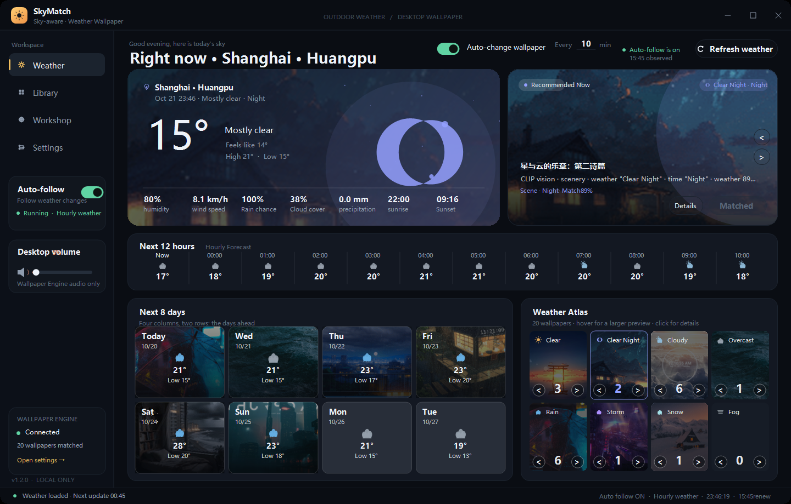
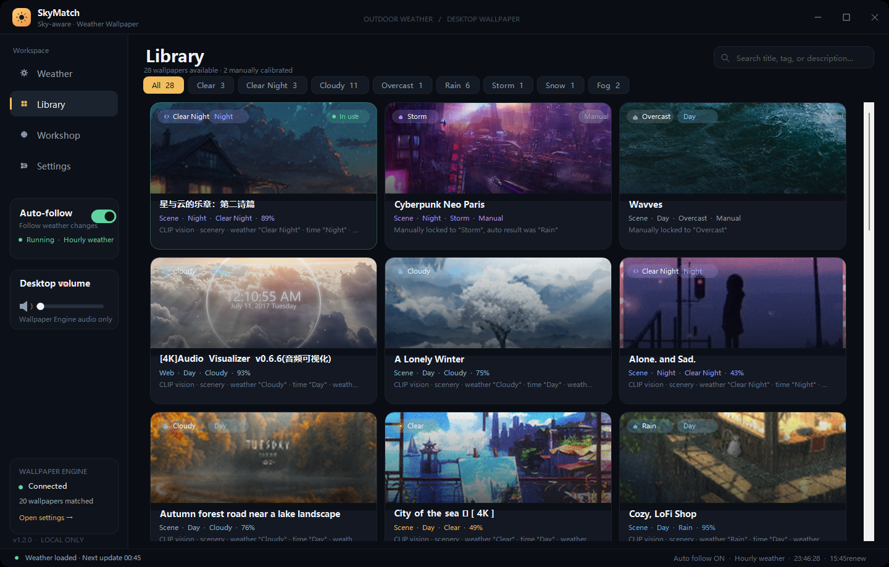
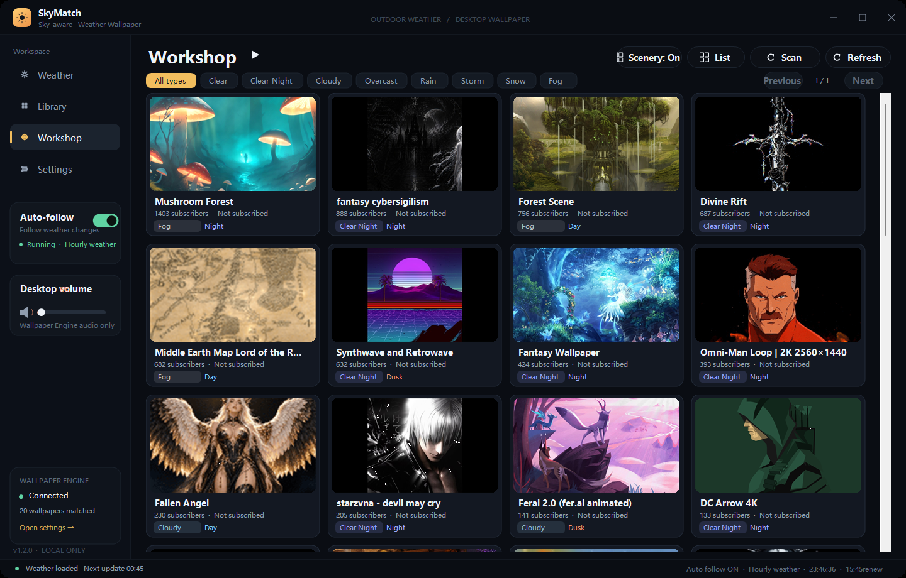
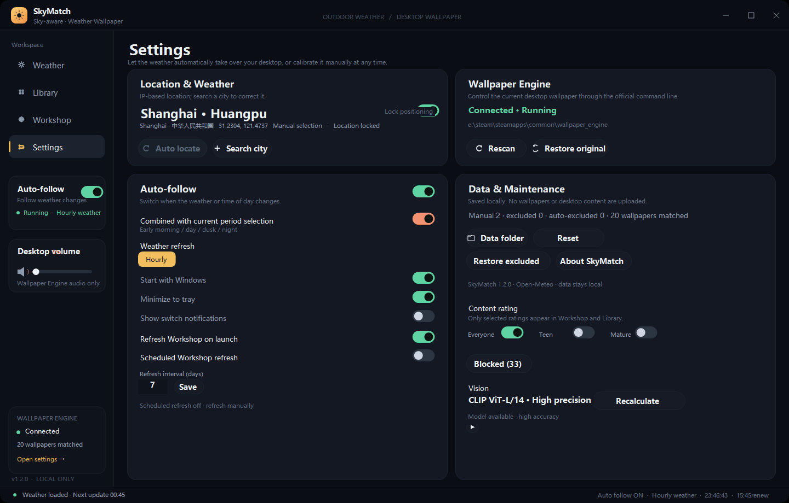

<div align="center">


# SkyMatch

**A weather-aware wallpaper matcher for Windows and Wallpaper Engine.**

SkyMatch reads the live weather at your location, combines it with the time of day, and picks a wallpaper from your subscribed Wallpaper Engine library or the Steam Workshop. It can switch automatically when the weather, the light, or your schedule changes.

[](https://github.com/zikTokito/SkyMatch/releases)
[](LICENSE)
[](#requirements)
[](https://dotnet.microsoft.com/download/dotnet-framework/net48)
[](https://github.com/zikTokito/SkyMatch/actions/workflows/build.yml)

**English** | [Chinese](README.zh-CN.md)

</div>

---

> **Short version:** SkyMatch does not subscribe to wallpapers for you. It reorganizes the wallpapers you already own by weather, time of day, and visual content, then hands the selected one to Wallpaper Engine. All classification and caching happen locally; no wallpaper image or desktop screenshot is uploaded.

> **Author / maintainer:** **Trzipx**  
> **Status:** working personal project, actively iterated.  
> **Best for:** Windows users who use Wallpaper Engine and want an atmospheric desktop without building a manual playlist.  
> **Not for:** users who need 100% classification accuracy, zero CPU usage, or a permissive non-copyleft license.

The application is available as an **English build** (`v1.2.0-en`) and a Chinese build (main release). The English build uses the same algorithms and data, with English UI strings.

## Table of contents

- [Features](#features)
- [Screenshots](#screenshots)
- [How it works](#how-it-works)
- [Algorithms](#algorithms)
  - [1. Wallpaper discovery and parsing](#1-wallpaper-discovery-and-parsing)
  - [2. Geolocation and weather](#2-geolocation-and-weather)
  - [3. Visual features](#3-visual-features)
  - [4. Heuristic weather and time-of-day classification](#4-heuristic-weather-and-time-of-day-classification)
  - [5. CLIP zero-shot classification](#5-clip-zero-shot-classification)
  - [6. Person detection and content filtering](#6-person-detection-and-content-filtering)
  - [7. Ranking and match score](#7-ranking-and-match-score)
  - [8. Auto-follow state machine](#8-auto-follow-state-machine)
  - [9. Workshop crawling and sorting](#9-workshop-crawling-and-sorting)
  - [10. Hidden whitelist and blocking](#10-hidden-whitelist-and-blocking)
  - [11. Performance strategy](#11-performance-strategy)
- [Advantages and limitations](#advantages-and-limitations)
- [Requirements](#requirements)
- [Quick start](#quick-start)
- [Build from source](#build-from-source)
- [Project structure](#project-structure)
- [Data and privacy](#data-and-privacy)
- [FAQ](#faq)
- [Roadmap](#roadmap)
- [Contributing](#contributing)
- [License](#license)
- [Third-party components](#third-party-components)
- [Credits](#credits)

## Features

### Weather and desktop

- **City / district geolocation:** IP-based location plus reverse geocoding to the district level. Search in Chinese or English, keep the last eight cities, and lock the location if desired.
- **Live weather overview:** temperature, apparent temperature, humidity, wind, rain probability, cloud cover, precipitation, sunrise, and sunset.
- **Hourly forecast:** starts at the current hour and rolls forward; recalculated every 30 seconds rather than frozen at fetch time.
- **Eight-day forecast in windowed mode:** arranged as a 4×2 grid. Fullscreen mode expands to 24 hours + 7 days with the existing wide layout.
- **Weather atlas:** each weather category shows a representative wallpaper. Click a category to jump to the matching library filter.
- **External-switch sync:** if you change the wallpaper manually in Wallpaper Engine, SkyMatch reads the active wallpaper every five seconds and refreshes the “in use” state.

### Wallpaper library

- Scans Wallpaper Engine’s subscribed/downloaded wallpapers under `steamapps/workshop/content/431960`.
- Subscribed local wallpapers automatically enter a **hidden whitelist**. They appear in the library regardless of Steam tags, scenery preference, or person detection, while manual blocks, manual exclusions, and age ratings still apply.
- Weather filters, title/tag/description search, grid cards, hover previews, and per-wallpaper scoring details.
- Manually lock a wallpaper to one weather category, restore automatic classification, hide it, or block it.
- Each weather tab remembers its own scroll position and recalculates its scroll range when switching.
- The local library uses a fixed 3-column layout in windowed mode and 5 columns when maximized, preventing cards from stretching.

### Workshop highlights

- Crawls Steam’s `mostsubscribed` workshop pages, then sorts by **unique subscriber count**; vote counts and rank badges are not shown.
- Scenery preference on: up to 100 items for each of 9 content tags. Off: up to 50 items for each of 25 tags, merged and deduplicated.
- Grid/list views, weather filters, pagination, search, hover previews, direct apply, and an “open Workshop” action for uninstalled items.
- Progressive results: each fetched page is appended immediately; previews, cache, and final sorting continue in the background.
- Missing Steam SSR preview size parameters are repaired by trying 637×358, 1024×1024, and 5000×5000 CDN variants.
- Videos larger than 10 MB are skipped. Solid-color previews are hidden from Workshop results; locally downloaded copies remain in the library but are excluded from matching.
- Workshop cache lasts 12 hours; a manual refresh is available.

### Auto-follow

- Weather refreshes hourly; the time slot is checked every 30 seconds. Matching is triggered only when the weather category or time slot actually changes.
- **Switch only when needed:** if the current wallpaper already matches the current weather and time slot, a higher-scoring wallpaper is not loaded just because it exists.
- **Fullscreen protection:** automatic switching and recommendation rotation pause while a fullscreen game or video is in the foreground. A deferred check resumes after leaving fullscreen.
- **Recommendation rotation:** a home-page toggle plus an inline “Every __ minutes” field. The field is hidden when the toggle is off and fades in when enabled. Rotation only chooses from candidates that match the current weather/time.
- Tray mode, start with Windows, notifications, pause auto-follow, and restore the original wallpaper.
- Switching uses Wallpaper Engine’s official command-line control; Steam files are never modified.

### Vision and content controls

- Fixed **CLIP ViT-L/14** local inference for weather, time of day, and subject (character vs. scenery).
- First full classification downloads workshop previews and runs inference once. Results are cached in `vision-cache.json`; later runs only classify new or changed previews.
- Optional **YOLOv8n** person detection; scenery preference filters previews containing people, including small distant figures.
- Content ratings: Everyone / Questionable / Mature, selectable in any combination. Local wallpapers read `contentrating`; Workshop items use rating tags.
- Hidden whitelist, manual blocks, manual calibration, and automatic exclusions have explicit priority rules.
- Models run offline. Loading CLIP L/14 requires roughly 700–800 MB of RAM.

## Screenshots

<div align="center">

| Weather dashboard | Wallpaper library |
|:---:|:---:|
|  |  |

| Workshop highlights | Settings |
|:---:|:---:|
|  |  |

</div>

> The screenshots use a public demo location and the English build.

## How it works

```text
┌──────────────────────┐      ┌──────────────────────┐
│ Wallpaper Engine      │      │ Open-Meteo / IP geo  │
│ 431960 / project.json │      │ current + 8-day data │
└──────────┬───────────┘      └──────────┬───────────┘
           │                             │
           ▼                             ▼
   ┌───────────────┐             ┌───────────────┐
   │ Wallpaper      │             │ Weather        │
   │ parser         │             │ 8 classes      │
   │ type/tags/img  │             │ 4 time slots   │
   └───────┬───────┘             └───────┬───────┘
           │                             │
           ▼                             ▼
   ┌───────────────┐             ┌───────────────┐
   │ CLIP / YOLO   │             │ Ranking        │
   │ local vision  │────────────▶│ weather+time+  │
   └───────────────┘             │ popularity     │
                                 └───────┬───────┘
                                         │
                                         ▼
                                 ┌───────────────┐
                                 │ Auto-follow    │
                                 │ fullscreen /   │
                                 │ already match  │
                                 └───────┬───────┘
                                         │
                                         ▼
                                 Wallpaper Engine CLI
```

SkyMatch is a **recommender and scheduler**, not a replacement for Wallpaper Engine:

1. Scan and classify the wallpapers you already own.
2. Read the current weather, time slot, and user filters.
3. Score every eligible wallpaper.
4. Apply a wallpaper only when it is needed or when the user asks.
5. Cache classification results, Workshop metadata, and previews locally.

## Algorithms

> This section describes the actual implementation in version `1.2.0`. Parameters may change; the source under [`src/`](src/) is authoritative.

### 1. Wallpaper discovery and parsing

**Entry points:** `WallpaperScanner.Scan()`, `WallpaperEngineController`

- Finds Wallpaper Engine through the registry and common install paths, then reads `config.json` → `selectedwallpapers` for the active wallpaper of each monitor.
- Enumerates every Steam library through `libraryfolders.vdf` and scans:
  `steamapps/workshop/content/431960/<workshopId>/`
- A project must contain `project.json`. SkyMatch parses title, type, file, preview, tags, content rating, author, and Workshop ID.
- Allowed wallpaper payloads: `.pkg`, `.mp4`, `.webm`, `.html`, `.htm`, `.json`.
- Skipped or excluded:
  - directories without `project.json`;
  - pure applications, effects, audio visualizers, clocks, mouse trails, and other non-wallpaper projects;
  - local videos larger than **10 MB** (to avoid decode stalls);
  - avatars, phone/vertical wallpapers, logos, text-only images, test/template projects, and other unsuitable desktop items.
- Scene wallpapers prefer `scene.pkg`; video/Web wallpapers use the actual media file. The resulting `LaunchPath` is passed to Wallpaper Engine.
- Downloaded wallpapers are joined to Workshop candidates by Workshop ID to drive “installed / in use” state.

### 2. Geolocation and weather

**Entry points:** `WeatherService`, `AppController.LocateByIpAsync()`

IP geolocation fallback chain:

1. `freeipapi.com/api/json`
2. `ip-api.com/json/?lang=zh-CN`
3. `ipwho.is/`
4. Manual city search: Open-Meteo Geocoding API
5. District reverse geocoding: BigDataCloud reverse-geocode-client

Weather comes from **Open-Meteo**:

```text
https://api.open-meteo.com/v1/forecast
  ?latitude=...&longitude=...
  &current=temperature_2m,relative_humidity_2m,apparent_temperature,
           is_day,precipitation,weather_code,cloud_cover,wind_speed_10m
  &hourly=temperature_2m,weather_code,precipitation_probability,is_day
  &daily=weather_code,temperature_2m_max,temperature_2m_min,
         sunrise,sunset,precipitation_probability_max
  &timezone=auto&forecast_days=8
```

WMO weather codes are mapped to eight internal categories:

| Category | Typical weather |
|---|---|
| `ClearDay` | clear / mostly clear, daytime |
| `ClearNight` | clear night |
| `Cloudy` | partly cloudy / cloudy |
| `Overcast` | overcast |
| `Rain` | light rain, rain, showers |
| `Storm` | thunderstorms, severe convection |
| `Snow` | snow, sleet, snow showers |
| `Fog` | fog, haze, low visibility |

Time slots are fixed local-clock ranges:

| Slot | Time |
|---|---|
| Dawn | 05:00–09:00 |
| Day | 09:00–17:00 |
| Dusk | 17:00–20:00 |
| Night | 20:00–05:00 |

Weather refreshes hourly. Time-slot changes are checked every 30 seconds. Cached weather is shown offline, then refreshed in the background when due.

### 3. Visual features

**Entry point:** `WallpaperClassifier.AnalyzePreview()`

Each preview is center-cropped into a 72×72 thumbnail. Per pixel:

- luminance `L = 0.299R + 0.587G + 0.114B`;
- saturation `S = (max(R,G,B) - min(R,G,B)) / max(R,G,B)`;
- dark ratio: `L < 0.22`;
- bright ratio: `L > 0.78`;
- gray ratio: `S < 0.13`;
- warm / cool / purple / green weights accumulated as `S × (0.35 + L)` over hue ranges;
- contrast: luminance standard deviation × 3, clamped to 1;
- mean brightness, saturation, warmth, coolness, purple, and green.

These features feed heuristic classification, time-of-day scoring, and solid-color detection.

### 4. Heuristic weather and time-of-day classification

**Entry point:** `WallpaperClassifier.ClassifyCore()`

For each of the eight weather categories:

```text
weatherScore(kind) = max(-2, keywordScore × 0.72 + visualScore × 1.85)
```

For each of the four time slots:

```text
timeScore(slot) = max(-2, keywordScore × 0.78 + visualScore × 1.65)
```

- `keywordScore` comes from weighted matches in title, tags, and description.
- `visualScore` is a linear score over brightness, darkness, cool/warm hue, gray, purple, and related features.
- Confidence:

```text
confidence = clamp(58 + 38 × (topScore - secondScore) / (|secondScore| + 2.5), 50, 96)
```

- Game and franchise names are stripped before text scoring, so titles such as “Odyssey Twilight Creed” do not dominate the weather decision.
- Hard-reject terms such as avatar, profile picture, phone wallpaper, vertical, logo, text-only, test, or template mark an item unsuitable.

The heuristic is a fast fallback and text correction. Final classification is driven by CLIP; `ClassifyOne()` merges the CLIP and heuristic outputs and keeps confidence and reason strings.

### 5. CLIP zero-shot classification

**Entry point:** `ClipVisionClassifier`

Model: `models/clip-large/vision_model.onnx`, a CLIP ViT-L/14 vision encoder.

1. Resize the preview so its shorter edge is 224 px, then center-crop to 224×224.
2. Normalize with CLIP mean/std:
   `mean = (0.48145466, 0.4578275, 0.40821073)`
   `std = (0.26862954, 0.26130258, 0.27577711)`
3. Run ONNX Runtime to obtain the image embedding.
4. Dot-product it with the precomputed text embeddings in `prompt_embeddings.json`.
5. Take the maximum similarity for each category’s prompt group.
6. Apply softmax with temperature 100 for weather and time-of-day.
7. Character vs. scenery uses a separate prompt group with temperature 20; the character probability threshold is `0.63`.
8. Confidence = highest category probability × 100.

Prompt groups cover:

- eight weather categories;
- four time slots;
- character close-up, wide scenery, and distant-figure subject judgments.

Everything runs locally. `prompt_embeddings.json` contains fixed vectors generated offline with the CLIP text encoder; it contains no user data.

### 6. Person detection and content filtering

**Entry points:** `PersonDetector`, `WorkshopTagFilter`, `AgeRatingInfo`

- **YOLOv8n** receives a 640×640 letterboxed image. Any `person` detection with confidence ≥ **0.20** counts as containing a person.
- With scenery preference enabled, person detections filter Workshop candidates and automatic recommendations, including small distant figures.
- The scenery tag blacklist includes cartoon, anime, game, girls/female, guys/male, medieval, influencer, MMD, music, sci-fi, sports, technology, TV show, cars, 3D, unspecified style, and similar tags.
- Content ratings apply to both local and Workshop items:
  - Everyone;
  - Questionable;
  - Mature;
  - at least one rating must remain selected.
- Solid-color previews (black, gray, or a single color) are detected by `PreviewQuality.IsSolidColor()`; Workshop items are hidden, while local items stay in the library but are excluded from matching.

### 7. Ranking and match score

**Entry points:** `AppController.GetRanked()`, `CombinedScore()`

For every candidate:

```text
score = weatherMatchScore
      + (useTime ? timeScore × 1.05 : 0)
      + (useTime && primaryTime == slot ? 2.5 : 0)
      + (weather == currentKind ? 2.0 : 0)
      - (useTime && primaryTime == Night && slot != Night ? 2.2 : 0)
      - (useTime && primaryTime != Night && slot == Night ? 0.8 : 0)
      + workshopSubscriptionBonus
      - (characterFocus ? 1.8 : 0)

workshopSubscriptionBonus = min(3.2, log10(1 + subscriptions) / 1.55)
```

Sort order:

1. combined score descending;
2. exact weather match first;
3. confidence descending;
4. manual calibration first;
5. title, case-insensitive.

“Exact category” is preferred. When no exact wallpaper exists, the best approximate candidate is used and the UI marks it as approximate. Workshop popularity is only a small bonus; vote counts are never used for ordering.

### 8. Auto-follow state machine

**Entry points:** `AutoFollowAsync()`, `CheckTimeChangeAsync()`, `CheckRecommendationRotationAsync()`, `ResumeDeferredAutoFollowAsync()`

Triggers:

- initial match at startup;
- weather category change after the hourly refresh;
- time-slot change when time-of-day matching is enabled;
- user clicking “Match current weather” or applying a wallpaper (manual actions are not blocked by fullscreen);
- the home-page rotation timer reaching its configured minute count.

Preconditions:

```text
auto-follow enabled
weather available
no switch already in progress
no foreground fullscreen app (game / fullscreen video)
current wallpaper does not match the current weather / time slot
```

If the current wallpaper already matches, SkyMatch returns without reloading Wallpaper Engine. This is the main defense against desktop stutter.

Fullscreen detection:

- `SHQueryUserNotificationState()` reports `QUNS_RUNNING_D3D_FULL_SCREEN` / `QUNS_PRESENTATION_MODE`;
- the foreground window covers the monitor;
- the window has no caption and no thick frame;
- desktop, taskbar, and SkyMatch itself are excluded;
- fullscreen only records a deferred flag; after leaving fullscreen, a 30-second timer resumes the check.

Recommendation rotation:

- only chooses from `GetRanked()` for the current weather/time;
- starts from the wallpaper after the current active one and wraps around;
- stops immediately when the rotation toggle is off;
- never rotates while fullscreen.

### 9. Workshop crawling and sorting

**Entry points:** `SteamWorkshopService`, `RefreshWorkshopAsync()`

- Page: `https://steamcommunity.com/workshop/browse/?appid=431960&browsefilter=mostsubscribed&p=N`
- Routes: English + US storefront, then English, then default.
- 25 Steam content tags (only 9 when scenery preference is on), 100 / 50 items per tag.
- Parse embedded SSR JSON first; fall back to HTML title/preview/tag extraction.
- Merge and deduplicate; sort by `subscriptions` descending, then `votes`, then title.
- Skip videos with `file_size > 10 MB`.
- Preview URL repair:
  - `//steamusercontent...` → `https://...`;
  - UGC directory without a size suffix → try 637×358, 1024×1024, 5000×5000;
  - one image is limited to 8 MB.
- Progressive loading: append each page as it arrives; fetch the first 40 previews for the first screen, then continue in the background.
- Cache for 12 hours; cached entries include metadata, preview path, subscribers, and classification.

Steam has no official API for third-party subscription clicks. Uninstalled items open the Workshop page; after the user subscribes and downloads, SkyMatch detects the local folder and refreshes without requiring a restart.

### 10. Hidden whitelist and blocking

**Entry points:** `GetLibraryWallpapers()`, `WhitelistIds`, `BlockedIds`, `HiddenIds`

- Every subscribed local wallpaper ID is automatically written to `WhitelistIds`.
- Whitelisted items appear in the library by default, bypassing Steam tags, scenery preference, person detection, and automatic unsuitability checks.
- The whitelist still respects:
  - manual blocks (`BlockedIds`);
  - manual exclusions (`HiddenIds`);
  - age ratings.
- Whitelisted items are **not automatically injected into the recommendation pool** unless they also satisfy the normal match filters.
- The blocked list is card-based and supports unblocking. Blocked wallpapers do not expose a detail view.

### 11. Performance strategy

- **Lazy pages:** startup creates only the dashboard; library, Workshop, and settings pages are built on first visit.
- **Vision cache:** `vision-cache.json` reuses results by wallpaper ID + preview modification time. Full local inference is delayed by five seconds and runs at below-normal thread priority.
- **Preview cache:** Workshop previews are stored on disk; thumbnails are generated in the background and missing previews are repaired after startup.
- **Incremental refresh:** hidden pages only set a dirty flag; switching wallpapers repaints the current card instead of rebuilding everything.
- **Lightweight state updates:** the dashboard only syncs the “matched / apply” button instead of recomputing the whole recommendation page.
- **Fullscreen protection and no-op matching:** fewer Wallpaper Engine scene reloads, which are the real source of frame drops.
- **Single .NET executable:** no Python, Node.js, or extra runtime is required; models and ONNX Runtime ship with the portable release.

## Advantages and limitations

### Advantages

| Advantage | Why it matters |
|---|---|
| **Local-first** | Weather requests contain only location/weather data; wallpapers, screenshots, and vision results are never uploaded. |
| **No account or API key** | Uses Open-Meteo, public IP geolocation, and public Steam pages. |
| **Uses wallpapers you already own** | Does not alter Steam files or fake subscriptions; delegates the switch to Wallpaper Engine’s official command line. |
| **Offline vision** | CLIP / YOLO run through local ONNX inference; caches still work without a network. |
| **Weather + time of day** | Not a simple “rain → one image” rule; weather, light, scenery, and character preference all contribute. |
| **Correctable** | Manual weather locks, blocks, exclusions, whitelist, and age ratings prevent one bad prediction from being permanent. |
| **Fewer pointless switches** | Already-matching wallpapers are left alone; fullscreen games/videos pause automatic switching. |
| **English + Chinese UI** | Separate English and Chinese builds; same engine, algorithms, and local data format. |
| **Auditable** | C# source, scoring parameters, request URLs, and sorting rules are all in the repository. |

### Limitations and risks

| Limitation | Description / mitigation |
|---|---|
| **Windows only** | Depends on .NET Framework 4.8, WinForms, Wallpaper Engine, and Windows audio sessions. |
| **Wallpaper Engine required** | Without it SkyMatch can scan folders but cannot apply a wallpaper. |
| **Slow first classification** | The L/14 model uses about 700–800 MB of RAM; the first full run downloads previews and may take minutes. Later runs use the cache. |
| **CPU inference** | No dedicated GPU backend; low-end CPUs can be busy during bulk classification. Work is delayed and run at lower priority. |
| **Not 100% accurate** | CLIP zero-shot + keyword heuristics can misread abstract images, mixed weather, and text-heavy images. Manual calibration exists. |
| **Steam page changes** | Workshop crawling depends on public SSR/HTML; Steam redesigns, rate limits, and 502 errors affect results. |
| **Missing Workshop previews** | Some UGC assets are unavailable at the CDN. Multi-size fallback helps but cannot guarantee an image. |
| **Fullscreen edge cases** | Borderless windows, multi-monitor setups, and overlays can be misdetected; disabling auto-follow avoids the issue. |
| **No automatic subscription** | Uninstalled Workshop items open the Steam page; the user must confirm the subscription. |
| **Large models** | The portable package is about 240 MB; the Git repository does not contain model weights. |
| **AGPL-3.0** | Optional YOLOv8n is AGPL-3.0; the project is released as AGPL-3.0. Commercial use and redistribution carry copyleft obligations. |
| **No code signing** | Self-built executables may trigger SmartScreen “unknown publisher”. |
| **No in-app language switch** | English and Chinese builds are separate executables; UI language is fixed per build. |

## Requirements

- Windows 10 / 11, 64-bit
- [.NET Framework 4.8](https://dotnet.microsoft.com/download/dotnet-framework/net48) (usually included with Windows 10 2004+)
- [Wallpaper Engine](https://store.steampowered.com/app/431960/Wallpaper_Engine/) on Steam
- Network access on first launch (location / weather / Workshop)
- At least 4 GB of available RAM recommended; CLIP L/14 loads about 700–800 MB

## Quick start

### English build

Use the **English release** if you want an English UI:

- [SkyMatch 1.2.0 English release](https://github.com/zikTokito/SkyMatch/releases/tag/v1.2.0-en)
- `SkyMatch-1.2.0-English-Setup.exe`
- `SkyMatch-1.2.0-English-Portable.zip`

The English build uses the same local cache format as the Chinese build. English source lives on the [`english` branch](https://github.com/zikTokito/SkyMatch/tree/english).

### Option 1: installer (recommended)

1. Open [Releases](https://github.com/zikTokito/SkyMatch/releases/latest).
2. Download `SkyMatch-1.2.0-Setup.exe`.
3. Run it. The default install location is `%LOCALAPPDATA%\Programs\SkyMatch`.
4. Start SkyMatch and make sure Wallpaper Engine is running.

The installer creates desktop and Start-menu shortcuts and does not require administrator rights.

### Option 2: portable package

1. Download `SkyMatch-1.2.0-Portable.zip`.
2. Extract it anywhere.
3. Run `SkyMatch.exe`.

User caches, location history, blocked lists, and Workshop previews are not bundled; they are written to `%LOCALAPPDATA%\SkyMatch`.

### First run

1. Wait for IP geolocation and weather.
2. SkyMatch scans local wallpapers and classifies them.
3. The dashboard shows the current recommendation.
4. To pause automatic switching, turn off the **Auto-follow** toggle.
5. To restore the original wallpaper: Settings → Wallpaper Engine → Restore original wallpaper.

> If switching wallpapers stutters or drops frames, turn off **Use high-precision timer** in Wallpaper Engine: Settings → General → Advanced.

## Build from source

### Prerequisites

- Windows 10 / 11
- .NET Framework 4.8 Developer Pack (or the system `csc.exe`)
- PowerShell 5.1+
- Optional: Wallpaper Engine for runtime testing
- Visual Studio is not required; `build.ps1` calls `csc.exe` directly

### 1. Clone

```powershell
git clone https://github.com/zikTokito/SkyMatch.git
cd SkyMatch
```

### 2. Import models

Model weights are large and are **not stored in Git**. Extract them from the latest portable release:

```powershell
# Download SkyMatch-1.2.0-Portable.zip into the current directory first.
.\scripts\import-models.ps1 -PortableZip .\SkyMatch-1.2.0-Portable.zip
```

The script only extracts `models/` and verifies:

```text
models/clip-large/vision_model.onnx
models/clip-large/config.json
models/clip-large/preprocessor_config.json
models/clip-large/prompt_embeddings.json
models/yolo/yolov8n.onnx
```

You can skip models if you only need to compile. The app falls back to preview features and keywords, but recommendation quality drops.

<details>
<summary>Manual model setup</summary>

- CLIP ViT-L/14 ONNX: `onnx/vision_model.onnx` and config from `Xenova/clip-vit-large-patch14`;
- text prompt vectors: `assets/prompt_embeddings.json`;
- YOLOv8n ONNX: export `yolov8n.onnx` with Ultralytics (AGPL-3.0).

Directory layout:

```text
models/
├── clip-large/
│   ├── vision_model.onnx
│   ├── config.json
│   ├── preprocessor_config.json
│   └── prompt_embeddings.json
└── yolo/
    └── yolov8n.onnx
```

</details>

### 3. Build

```powershell
.\build.cmd
```

Output:

```text
dist\SkyMatch.exe
dist\models\...
dist\onnxruntime.dll
```

### 4. Run

```powershell
.\dist\SkyMatch.exe
```

Release packaging is optional. The installer source lives in `installer/`.

## Project structure

```text
SkyMatch/
├─ src/
│  ├─ AppController.cs          # scanning, matching, auto-follow, switching
│  ├─ AppConfig.cs              # settings / cache / paths
│  ├─ Models.cs                 # wallpaper, weather, settings models
│  ├─ Program.cs                # entry point
│  ├─ Services/
│  │  ├─ WallpaperScanner.cs    # Steam library / Workshop scanning
│  │  ├─ WallpaperClassifier.cs # visual features + heuristics
│  │  ├─ ClipVisionClassifier.cs# CLIP ONNX zero-shot classification
│  │  ├─ PersonDetector.cs      # YOLOv8n person detection
│  │  ├─ PreviewQuality.cs      # solid-color / preview quality
│  │  ├─ WeatherService.cs      # geolocation + Open-Meteo
│  │  ├─ WorkshopService.cs     # Workshop crawl + preview fallback
│  │  ├─ WorkshopTagFilter.cs   # scenery tag blacklist
│  │  ├─ WallpaperEngineController.cs
│  │  ├─ WallpaperAudioController.cs
│  │  ├─ FullscreenDetector.cs  # fullscreen app detection
│  │  └─ VisionCacheStore.cs
│  └─ UI/
│     ├─ MainForm.cs            # window / tray / timers
│     ├─ DashboardPage.cs       # weather, recommendation, rotation
│     ├─ LibraryPage.cs         # wallpaper library
│     ├─ WorkshopPage.cs        # Workshop highlights
│     ├─ SettingsPage.cs        # settings
│     ├─ Controls.cs            # custom controls / toggle / minute input
│     └─ Theme.cs               # dark theme
├─ assets/                      # icon / prompt embeddings
├─ docs/                        # screenshots / docs
├─ installer/                   # self-extracting installer source
├─ lib/                         # build DLLs / .NET reference assemblies
├─ scripts/import-models.ps1
├─ models/                      # local models (.gitignore, not in Git)
├─ build.cmd / build.ps1
├─ README.md
├─ THIRD_PARTY_NOTICES.md
└─ LICENSE
```

## Data and privacy

SkyMatch contains no telemetry, account system, or advertising SDK.

### Network requests

| Purpose | Domain |
|---|---|
| IP geolocation | `freeipapi.com`, `ip-api.com`, `ipwho.is` |
| Reverse geocoding | `api.bigdatacloud.net` |
| City search | `geocoding-api.open-meteo.com` |
| Weather | `api.open-meteo.com` |
| Workshop | `steamcommunity.com` |
| Workshop previews | `steamusercontent.com` |

Requests contain only IP, latitude/longitude, city name, or Workshop IDs. Wallpaper images, desktop screenshots, and local file contents are never uploaded.

### Local data

```text
%LOCALAPPDATA%\SkyMatch\
├─ settings.json          # location, toggles, blocks / whitelist, manual calibration
├─ weather-cache.json     # weather cache
├─ workshop-cache.json    # Workshop metadata
├─ vision-cache.json      # CLIP / feature results
├─ workshop-previews\     # Workshop preview images
└─ logs\                  # runtime logs
```

Deleting the directory resets the app to first-run state, but loses manual calibration, blocked lists, and caches.

### Privacy advice

- Do not commit `settings.json`, logs, or personal screenshots to a public repository.
- Redact real cities, account names, and desktop content from README screenshots.
- Workshop previews come from Steam’s public CDN and remain subject to Steam’s terms.

## FAQ

<details>
<summary><b>Why does switching wallpapers drop frames for a few seconds?</b></summary>

Wallpaper Engine loading a new scene is the main cause, not SkyMatch waiting on a process. SkyMatch pauses automatic switching while fullscreen and does not reload an already-matching wallpaper. If it still stutters:

- Wallpaper Engine → Settings → General → Advanced → disable **Use high-precision timer**;
- lower the recommendation rotation frequency;
- avoid manual switches to large scenes while gaming.
</details>

<details>
<summary><b>Weather update failed with a block-length / complement error</b></summary>

Older builds enabled both GZip and Deflate decompression; some weather responses returned a compressed stream that .NET `DeflateStream` rejected. Current builds use GZip only and show a friendly error. If it persists, delete `%LOCALAPPDATA%\SkyMatch\weather-cache.json` and retry.
</details>

<details>
<summary><b>Workshop previews return 502 or show blank</b></summary>

UGC preview URLs may lack a size suffix or be temporarily unavailable. SkyMatch tries 637×358, 1024×1024, and 5000×5000. If all fail, the candidate can still be listed without an image. Wait for the CDN or refresh the Workshop data.
</details>

<details>
<summary><b>First classification is very slow / memory usage is high</b></summary>

CLIP ViT-L/14 uses about 700–800 MB. The first run downloads Workshop previews and runs full inference; results are cached in `vision-cache.json`. Later runs only classify new items. Turning off scenery preference also avoids YOLO detection.
</details>

<details>
<summary><b>Why is my wallpaper missing from recommendations?</b></summary>

Possible reasons:

- manually blocked or excluded;
- age rating not selected;
- scenery preference + person detection;
- solid-color preview;
- video larger than 10 MB;
- a locally subscribed whitelist item only guarantees library visibility, not recommendation pool entry.
</details>

<details>
<summary><b>Does SkyMatch collect my data?</b></summary>

No telemetry. Weather and Workshop requests contain only location / wallpaper IDs, and vision runs locally. See [Data and privacy](#data-and-privacy).
</details>

## Roadmap

- [ ] More robust fullscreen detection (multi-monitor / overlays)
- [ ] Optional GPU inference (DirectML / CUDA)
- [ ] Finer weather transitions (rain clearing, sunrise/sunset warmth)
- [x] English UI build
- [ ] Configurable Workshop tags / counts
- [ ] More automated tests and screenshot comparisons

## Contributing

Issues and pull requests are welcome. Read [CONTRIBUTING.md](CONTRIBUTING.md) first.

- Bug reports: include Windows version, Wallpaper Engine version, reproduction steps, and relevant `%LOCALAPPDATA%\SkyMatch\logs` lines after redaction.
- Algorithm changes: explain the effect on false positives, performance, and licensing.
- Do not commit model weights, user caches, personal screenshots, or Steam credentials.

## License

The project is released under the **GNU Affero General Public License v3.0 (AGPL-3.0)**. See [LICENSE](LICENSE).

Why AGPL:

- the optional **Ultralytics YOLOv8n** model is AGPL-3.0;
- distributing the app with that model makes AGPL the safest overall license;
- if you only need an MIT-compatible subset, remove YOLO person detection and replace it with a license-compatible detector, but verify the combined license yourself.

Copyright (C) 2026 **Trzipx**.

## Third-party components

See [THIRD_PARTY_NOTICES.md](THIRD_PARTY_NOTICES.md) for the full list.

- OpenAI CLIP (MIT)
- Xenova CLIP ViT-L/14 ONNX conversion
- ONNX Runtime (MIT)
- Ultralytics YOLOv8n (AGPL-3.0)
- Open-Meteo / BigDataCloud / IP geolocation services (their own terms)
- Wallpaper Engine / Steam (Valve terms)

SkyMatch is not affiliated with Valve, Wallpaper Engine, OpenAI, or Ultralytics.

## Credits

- **Author / maintainer:** Trzipx
- Thanks to OpenAI CLIP, ONNX Runtime, Ultralytics, Xenova, and Open-Meteo for open models and data services.
- Thanks to the Wallpaper Engine community for the wallpapers and previews that make desktop customization possible.

---

<div align="center">

If SkyMatch makes your desktop feel a little more connected to the sky outside, consider giving it a star.

**[Back to top](#skymatch)**

</div>
