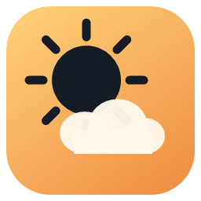
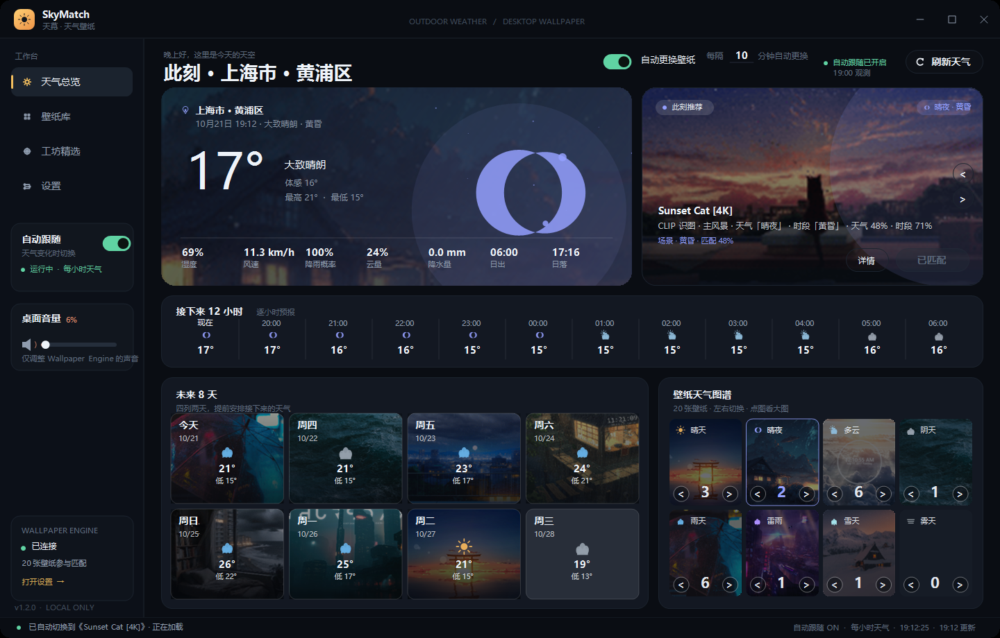
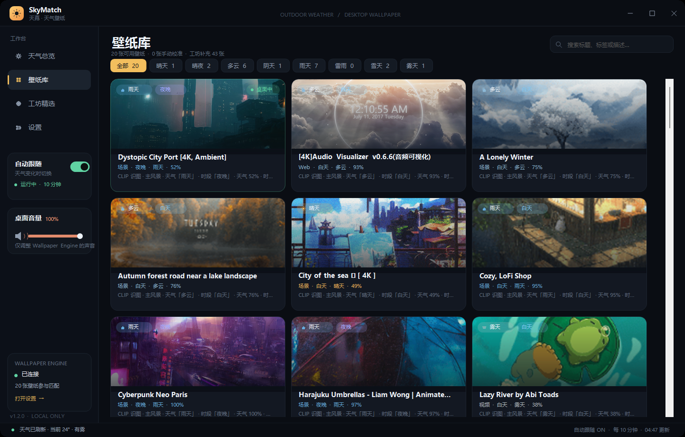
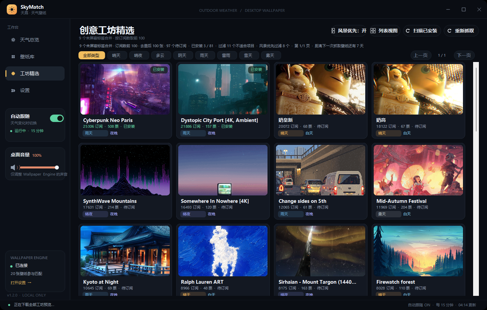
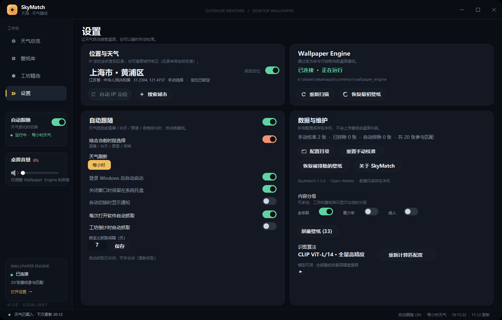

<div align="center">



# SkyMatch · 天幕

**让桌面壁纸跟着窗外的天气和光线走。**

[**English**](README.md) | 简体中文

> 英文 UI 版本：[SkyMatch 1.2.0 English](https://github.com/zikTokito/SkyMatch/releases/tag/v1.2.0-en)（Lite 包需另配 models）

一个面向 Windows + Wallpaper Engine 的本地优先天气壁纸匹配器。读取当前位置的实时天气，结合清晨 / 白天 / 黄昏 / 夜晚，从本机已订阅壁纸和 Steam 创意工坊候选中挑出一张，并在合适的时机自动切换。

[](https://github.com/zikTokito/SkyMatch/releases)
[](LICENSE)
[](#系统要求)
[](https://dotnet.microsoft.com/download/dotnet-framework/net48)

[功能](#功能) · [截图](#截图) · [算法](#算法) · [优势与局限](#优势与局限) · [快速开始](#快速开始) · [源码构建](#从源码构建) · [常见问题](#常见问题) · [许可证](#许可证)

</div>

---

> **一句话介绍**：SkyMatch 不替 Steam 订阅壁纸，而是把“你已经拥有的壁纸”按天气、时段和画面内容重新编排，交给 Wallpaper Engine 切换。识别、匹配和缓存全部在本机完成，不上传壁纸或桌面截图。

> **署名 / Author**：**Trzipx**
> **状态**：可运行的个人项目，仍在持续迭代。
> **适合**：喜欢桌面氛围、愿意为识图首次计算等待几分钟、使用 Wallpaper Engine 的 Windows 用户。
> **不适合**：需要 100% 准确分类、完全零 CPU 占用、或不愿接受 AGPL 许可证的用户。

## 目录

- [功能](#功能)
- [截图](#截图)
- [工作原理](#工作原理)
- [算法](#算法)
  - [1. 壁纸发现与解析](#1-壁纸发现与解析)
  - [2. 定位与天气](#2-定位与天气)
  - [3. 视觉特征](#3-视觉特征)
  - [4. 启发式天气 / 时段分类](#4-启发式天气--时段分类)
  - [5. CLIP 零样本分类](#5-clip-零样本分类)
  - [6. 人物检测与内容过滤](#6-人物检测与内容过滤)
  - [7. 排序与匹配分数](#7-排序与匹配分数)
  - [8. 自动跟随状态机](#8-自动跟随状态机)
  - [9. 创意工坊抓取与排序](#9-创意工坊抓取与排序)
  - [10. 隐藏白名单与屏蔽](#10-隐藏白名单与屏蔽)
  - [11. 性能策略](#11-性能策略)
- [优势与局限](#优势与局限)
- [系统要求](#系统要求)
- [快速开始](#快速开始)
- [从源码构建](#从源码构建)
- [目录结构](#目录结构)
- [数据与隐私](#数据与隐私)
- [常见问题](#常见问题)
- [路线图](#路线图)
- [贡献](#贡献)
- [许可证](#许可证)
- [第三方组件](#第三方组件)
- [致谢](#致谢)

## 功能

### 天气与桌面

- **定位到市 / 区**：IP 定位 + 经纬度反查区县；支持中文 / 英文城市搜索，保留最近 8 个城市，定位可锁定。
- **实时天气总览**：温度、体感、湿度、风速、降雨概率、云量、降水量、日出日落。
- **逐小时预报**：从当前整点开始滚动显示，页面每 30 秒按当前时间重算。
- **未来 8 天**：窗口模式 4×2 排列；全屏模式自动扩展为 24 小时 + 7 天宽屏布局。
- **天气图谱**：每种天气类型显示代表壁纸，点击分类直接跳到壁纸库对应筛选。
- **每 5 秒同步外部切换**：在 Wallpaper Engine 里手动换壁纸后，SkyMatch 自动读取当前活动壁纸并刷新「使用中」状态。

### 壁纸库

- 读取 Wallpaper Engine 已订阅 / 已下载壁纸，扫描 `steamapps/workshop/content/431960`。
- 本地已订阅壁纸自动进入**隐藏白名单**，不受 Steam 标签、风景优先、人物过滤影响，默认出现在壁纸库；仍遵守手动屏蔽、手动排除和年龄分级。
- 支持天气筛选、标题 / 标签 / 描述搜索、网格卡片、悬停大图、详情评分。
- 可把任意壁纸**手动锁定**到某个天气，或恢复自动识别；可排除 / 屏蔽。
- 每个天气标签独立记住滚动位置；切换标签重新计算滚动范围。
- 本地壁纸卡片按窗口模式固定 3 列、最大化固定 5 列，避免拉宽变形。

### 创意工坊精选

- 默认按 Steam 创意工坊 `mostsubscribed` 页面抓取候选，但最终按**不重复订阅人数**排序，不展示投票数或名次。
- 风景优先开启：为 9 个内容标签各取前 100 张；关闭：为 25 个标签各取前 50 张，合并去重。
- 支持网格 / 列表、天气筛选、分页、搜索、悬停预览、直接应用、未安装时订阅。
- 抓取过程渐进呈现；预览图、缓存和排序在后台补齐。
- Steam SSR 预览链接缺少尺寸参数时，依次尝试 637×358、1024×1024、5000×5000，修复 502 / 缺图。
- 大于 10 MB 的视频候选直接跳过；纯色块预览在工坊隐藏，本地已下载壁纸仍保留在壁纸库但默认不参与匹配。
- 抓取缓存 12 小时，可手动「重新抓取」。

### 自动跟随

- 天气每小时刷新；时段每 30 秒检查一次；只有天气类别或时段变化才触发匹配。
- **只在当前壁纸不匹配时切换**：已经匹配当前天气 / 时段的壁纸不会被“更高分”的壁纸替换。
- **全屏保护**：检测到全屏游戏 / 视频时暂停自动切换，退出全屏后恢复检查。
- **推荐轮换**：首页「自动更换壁纸」开关 + 「每隔 __ 分钟自动更换」输入；关闭时隐藏，打开时渐入；轮换只在当前天气 / 时段的候选里选。
- 关闭自动跟随、恢复最初壁纸、切换通知、关闭到托盘、开机启动。
- 通过 Wallpaper Engine 官方命令行切换，不直接改 Steam 文件；首次扫描保存原始壁纸，可随时恢复。

### 识图与内容控制

- 固定使用 **CLIP ViT-L/14** 离线识别天气、时段、主人物 / 主风景。
- 首次全量计算会逐张推理工坊预览；结果写入本地 `vision-cache.json`，后续复用，只补算新增 / 变化项。
- 可选 **YOLOv8n** 人物检测，风景优先时过滤包含人物的预览（包括远景小人）。
- 内容分级：全年龄 / 青少年 / 成人，可任意组合；本地读 `contentrating`，工坊读分级标签。
- 隐藏白名单、手动屏蔽、手动校准、自动排除，优先级明确。
- 模型离线运行，不上传壁纸；L/14 首次加载约 700–800 MB 内存。

## 截图

<div align="center">

| 天气总览 | 壁纸库 |
|:---:|:---:|
|  |  |

| 创意工坊 | 设置 |
|:---:|:---:|
|  |  |

</div>

> 截图中的地点为公开演示位置；发布前请确认自己的截图不包含真实住址、账号名或其他个人信息。

## 工作原理

```text
┌──────────────────────┐      ┌──────────────────────┐
│ Wallpaper Engine      │      │ Open-Meteo / IP 定位  │
│ 431960 / project.json │      │ 当前天气 + 8 天预报   │
└──────────┬───────────┘      └──────────┬───────────┘
           │                             │
           ▼                             ▼
   ┌───────────────┐             ┌───────────────┐
   │ 壁纸解析       │             │ 天气分类       │
   │ 类型/标签/预览 │             │ 8 类 + 4 时段  │
   └───────┬───────┘             └───────┬───────┘
           │                             │
           ▼                             ▼
   ┌───────────────┐             ┌───────────────┐
   │ CLIP / YOLO   │             │ 匹配评分       │
   │ 视觉分类       │────────────▶│ 天气+时段+热度 │
   └───────────────┘             └───────┬───────┘
                                         │
                                         ▼
                                 ┌───────────────┐
                                 │ 自动跟随状态机 │
                                 │ 全屏/已匹配跳过│
                                 └───────┬───────┘
                                         │
                                         ▼
                                 Wallpaper Engine CLI
```

SkyMatch 是“推荐器 + 调度器”，不是 Wallpaper Engine 的替代品：

1. 扫描并分类你已经拥有的壁纸；
2. 取当前天气、时段和用户筛选条件；
3. 计算每张壁纸的匹配分；
4. 只在不匹配或用户主动要求时，调用 Wallpaper Engine 切换；
5. 把识别结果、工坊目录和预览图缓存到本地。

## 算法

> 这里描述的是当前 `1.2.0` 源码的实际实现。算法参数会继续调整；以 [`src/`](src/) 为准。

### 1. 壁纸发现与解析

**入口**：`WallpaperScanner.Scan()`、`WallpaperEngineController`

- 通过注册表 / 常见安装路径查找 Wallpaper Engine，读取 `config.json` 中每个显示器的 `selectedwallpapers`，得到当前活动壁纸。
- 通过 Steam `libraryfolders.vdf` 枚举所有 Steam 库，扫描每个库的：
  `steamapps/workshop/content/431960/<workshopId>/`
- 每个项目必须存在 `project.json`；解析标题、类型、文件、预览、标签、内容分级、作者和工坊 ID。
- 允许的壁纸文件：`.pkg`、`.mp4`、`.webm`、`.html`、`.htm`、`.json`。
- 以下项目会被跳过或排除：
  - 没有 `project.json` 的目录；
  - 纯应用 / 特效 / 音频可视化 / 时钟 / 鼠标粒子等非壁纸类型；
  - 本地视频大于 **10 MB**（避免解码卡顿）；
  - 头像、手机竖屏、Logo、纯文字、测试 / 模板等不适合作为桌面壁纸的项目。
- 对场景壁纸优先使用 `scene.pkg`，对视频 / Web 壁纸使用实际媒体文件；生成 `LaunchPath` 交给 Wallpaper Engine。
- 已下载壁纸按工坊 ID 与工坊候选项关联，用于“使用中 / 已安装”状态。

### 2. 定位与天气

**入口**：`WeatherService`、`AppController.LocateByIpAsync()`

定位按容错链执行：

1. `freeipapi.com/api/json`
2. `ip-api.com/json/?lang=zh-CN`
3. `ipwho.is/`
4. 手动城市搜索：Open-Meteo Geocoding API
5. 经纬度反查区县：BigDataCloud reverse-geocode-client

天气来自 **Open-Meteo**：

```text
https://api.open-meteo.com/v1/forecast
  ?latitude=...&longitude=...
  &current=temperature_2m,relative_humidity_2m,apparent_temperature,
           is_day,precipitation,weather_code,cloud_cover,wind_speed_10m
  &hourly=temperature_2m,weather_code,precipitation_probability,is_day
  &daily=weather_code,temperature_2m_max,temperature_2m_min,
         sunrise,sunset,precipitation_probability_max
  &timezone=auto&forecast_days=8
```

WMO 天气代码映射为 8 类：

| 内部类别 | 典型天气 |
|---|---|
| `ClearDay` | 晴、主要晴朗（白天） |
| `ClearNight` | 晴夜 |
| `Cloudy` | 多云、局部多云 |
| `Overcast` | 阴天 |
| `Rain` | 小雨、中雨、阵雨 |
| `Storm` | 雷雨、强对流 |
| `Snow` | 雪、雨夹雪、阵雪 |
| `Fog` | 雾、霾、低能见度 |

时段是固定本地时钟区间：

| 时段 | 时间 |
|---|---|
| 清晨 `Dawn` | 05:00–09:00 |
| 白天 `Day` | 09:00–17:00 |
| 黄昏 `Dusk` | 17:00–20:00 |
| 夜晚 `Night` | 20:00–05:00 |

天气每小时刷新；跨时段检查每 30 秒执行。缓存会记录抓取时间，旧缓存可离线显示，但过期后会后台刷新。

### 3. 视觉特征

**入口**：`WallpaperClassifier.AnalyzePreview()`

对预览图做 72×72 的居中裁切缩略图，逐像素计算：

- 亮度 `L = 0.299R + 0.587G + 0.114B`；
- 饱和度 `S = (max(R,G,B) - min(R,G,B)) / max(R,G,B)`；
- 暗部比例：`L < 0.22`；
- 亮部比例：`L > 0.78`；
- 灰色比例：`S < 0.13`；
- 暖色 / 冷色 / 紫色 / 绿色权重：按色相区间累计 `S × (0.35 + L)`；
- 对比度：亮度标准差 × 3，截断到 1；
- 平均亮度、平均饱和度、暖色度、冷色度、紫色度、绿色度。

这些特征是后续启发式分类、时段判断和纯色块检测的输入。

### 4. 启发式天气 / 时段分类

**入口**：`WallpaperClassifier.ClassifyCore()`

对 8 类天气分别计算：

```text
weatherScore(kind) = max(-2, keywordScore × 0.72 + visualScore × 1.85)
```

对 4 个时段分别计算：

```text
timeScore(slot) = max(-2, keywordScore × 0.78 + visualScore × 1.65)
```

- `keywordScore`：标题、标签、描述中该类别关键词的命中数 / 权重；
- `visualScore`：按亮度、暗部、冷色、暖色、灰度、紫色等特征构造的线性打分；
- 置信度：

```text
confidence = clamp(58 + 38 × (topScore - secondScore) / (|secondScore| + 2.5), 50, 96)
```

- 标题中的游戏 / 系列名会先做噪声清理，避免“奥德赛 暮光信条”这类标题把天气带偏；
- 命中头像、Profile、手机壁纸、竖屏、Logo、纯文字、测试 / 模板等硬拒绝词时，标记为不适配。

启发式只作为**快速兜底**和文字修正；最终识图以 CLIP 结果为主，`ClassifyOne()` 中会把启发式结果与 CLIP 结果合并，并保留置信度 / 依据文本。

### 5. CLIP 零样本分类

**入口**：`ClipVisionClassifier`

模型：`models/clip-large/vision_model.onnx`，CLIP ViT-L/14 视觉编码器。

1. 预览图缩放到短边 224，中心裁切成 224×224；
2. 按 CLIP 均值 / 方差归一化：
   `mean = (0.48145466, 0.4578275, 0.40821073)`
   `std = (0.26862954, 0.26130258, 0.27577711)`
3. ONNX Runtime 输出图像 embedding；
4. 与 `prompt_embeddings.json` 中预生成的文本 embedding 做点积；
5. 每个类别取该类别所有 prompt 的最高相似度；
6. 软最大化（温度 100）得到天气 / 时段分布；
7. 主人物 / 主风景使用单独 prompt 组（温度 20），主角概率阈值 `0.63`；
8. 置信度 = 最高类别概率 × 100。

prompt 组覆盖：

- 8 类天气；
- 4 个时段；
- 主人物特写 / 主风景 / 远景小人等主体判断。

模型完全本地运行；`prompt_embeddings.json` 是用 CLIP 文本编码器离线生成的固定向量，不包含用户数据。

### 6. 人物检测与内容过滤

**入口**：`PersonDetector`、`WorkshopTagFilter`、`AgeRatingInfo`

- **YOLOv8n** 输入 640×640 letterbox，输出候选中 `person` 类置信度 ≥ **0.20** 即视为包含人物；
- 风景优先开启时，人物检测结果会过滤工坊候选和自动推荐；远景小人也会被计入；
- 风景优先的标签黑名单包括：卡通、动漫、游戏、女性、男性、中世纪、网红事物、MMD、音乐、科幻、运动、科技、电视节目、汽车、3D、未指定样式等；
- 内容分级同时作用于本地和工坊：
  - 全年龄：`Everyone`；
  - 青少年：`Questionable`；
  - 成人：`Mature`；
  - 至少保留一档；
- 纯色块预览（黑、灰、单一颜色）通过 `PreviewQuality.IsSolidColor()` 检测；工坊直接隐藏，本地保留但不参与匹配。

### 7. 排序与匹配分数

**入口**：`AppController.GetRanked()`、`CombinedScore()`

对每张候选计算：

```text
score = weatherMatchScore
      + (useTime ? timeScore × 1.05 : 0)
      + (useTime && primaryTime == slot ? 2.5 : 0)
      + (weather == currentKind ? 2.0 : 0)
      - (useTime && primaryTime == Night && slot != Night ? 2.2 : 0)
      - (useTime && primaryTime != Night && slot == Night ? 0.8 : 0)
      + workshopSubscriptionBonus
      - (characterFocus ? 1.8 : 0)

workshopSubscriptionBonus = min(3.2, log10(1 + subscriptions) / 1.55)
```

排序键：

1. 综合分降序；
2. 天气精确匹配优先；
3. 置信度降序；
4. 手动校准优先；
5. 标题字典序。

“专属分类”优先；当某类没有专属壁纸时，仍会选综合分最高者，并在 UI 明确标注「近似推荐」。工坊订阅热度只作为小幅加权，不把投票数当排序依据。

### 8. 自动跟随状态机

**入口**：`AutoFollowAsync()`、`CheckTimeChangeAsync()`、`CheckRecommendationRotationAsync()`、`ResumeDeferredAutoFollowAsync()`

触发条件：

- 启动后首次匹配；
- 天气小时刷新后，天气类别变化；
- 时段变化（`UseTimeOfDay` 开启）；
- 用户点击「按天气匹配」或应用按钮（手动，不受全屏限制）；
- 首页「自动更换壁纸」打开且到达设定分钟数。

自动切换前检查：

```text
AutoFollow 开启
且 天气已就绪
且 当前没有正在切换
且 当前不在全屏程序（游戏 / 全屏视频）
且 当前壁纸不匹配当前天气 / 时段
```

如果当前壁纸已经匹配，直接返回，不重新加载 Wallpaper Engine —— 这是减少游戏 / 桌面掉帧的关键。

全屏检测：

- `SHQueryUserNotificationState()` 返回 `QUNS_RUNNING_D3D_FULL_SCREEN` / `QUNS_PRESENTATION_MODE`；
- 前台窗口完整覆盖显示器；
- 窗口无标题栏 / 无粗边框；
- 排除桌面、任务栏和 SkyMatch 自身；
- 全屏期间只记录“待恢复”，退出全屏后由 30 秒定时器恢复检查。

推荐轮换：

- 只从当前天气 / 时段的 `GetRanked()` 候选中选择；
- 从当前活动壁纸的下一张开始循环；
- 关闭「自动更换壁纸」立即停止；
- 全屏期间不轮换。

### 9. 创意工坊抓取与排序

**入口**：`SteamWorkshopService`、`RefreshWorkshopAsync()`

- 页面：`https://steamcommunity.com/workshop/browse/?appid=431960&browsefilter=mostsubscribed&p=N`
- 线路：英文 + 美国商店 → 英文 → 默认；
- 25 个 Steam 内容标签（风景优先开启时只用其中 9 个），每标签 100 / 50 条；
- SSR 页面中的 JSON 优先解析；失败时回退 HTML 标题 / 预览 / 标签抓取；
- 合并去重，按 `subscriptions` 降序、`votes` 次序、标题排序；
- 视频 `file_size > 10 MB` 跳过；
- 预览 URL 修复：
  - `//steamusercontent...` → `https://...`；
  - 无尺寸 UGC 目录 → 依次尝试 637×358、1024×1024、5000×5000；
  - 单张图片限制 8 MB；
- 渐进式加载：每页完成就追加，首屏先补 40 张预览，其余后台补齐；
- 缓存 12 小时；缓存包含候选元数据、预览路径、订阅数和识别结果。

Steam 不提供第三方“代替用户点击订阅”的官方接口，因此未安装项只能打开工坊页面；下载完成后 SkyMatch 自动检测本地目录并刷新，无需重启。

### 10. 隐藏白名单与屏蔽

**入口**：`GetLibraryWallpapers()`、`WhitelistIds`、`BlockedIds`、`HiddenIds`

- 本机扫描到的已订阅壁纸 ID 自动写入 `WhitelistIds`；
- 白名单项目默认进入壁纸库，绕过 Steam 标签、风景优先、人物检测和自动不适合判定；
- 但仍遵守：
  - 手动屏蔽 `BlockedIds`；
  - 手动排除 `HiddenIds`；
  - 年龄分级；
- 白名单项目**不自动进入推荐池**，除非它本身也满足匹配条件；
- 手动屏蔽列表使用卡片式管理，可取消屏蔽；被屏蔽壁纸不显示详情入口。

### 11. 性能策略

- **页面懒加载**：启动只创建首页；壁纸库 / 工坊 / 设置首次进入时构建。
- **识图缓存**：`vision-cache.json` 按壁纸 ID + 预览修改时间复用；本地完整推理延后 5 秒、低线程优先级执行。
- **预览缓存**：工坊预览落盘，缩略图后台生成，缺图启动后补齐。
- **增量刷新**：隐藏页面只记脏标记，不立即重建；切换壁纸只重绘当前卡片。
- **轻量状态更新**：首页只同步「已匹配 / 立即切换」按钮，不重算整页推荐与图片。
- **全屏保护 + 已匹配不切换**：减少 Wallpaper Engine 场景重载，这是实际掉帧的主要来源。
- **单文件 .NET**：无需额外运行库；模型和 ONNX Runtime 随包分发。

## 优势与局限

### 优势

| 优势 | 说明 |
|---|---|
| **本地优先** | 天气请求只发定位 / 天气 API；壁纸、截图、识图结果不上传。 |
| **无需账号 / API Key** | 使用 Open-Meteo、公开 IP 定位和 Steam 公共页面。 |
| **真正使用已订阅壁纸** | 不改 Steam 文件，不伪造订阅，只调用 Wallpaper Engine 官方命令行。 |
| **离线识图** | CLIP / YOLO 本地 ONNX 推理；断网时仍可使用缓存和本地分类。 |
| **天气 + 时段双维度** | 不是简单“下雨换一张”，而是天气、时段、风景 / 人物偏好共同排序。 |
| **可纠正** | 手动锁定天气、屏蔽、排除、白名单、年龄分级，避免算法一错到底。 |
| **减少无意义切换** | 当前壁纸已匹配时不重载；全屏游戏 / 视频期间暂停。 |
| **完整中文 UI** | 深色界面、天气图谱、工坊筛选、秒级时钟、托盘常驻。 |
| **可审计** | C# 源码完整，算法参数、请求地址、排序规则都在仓库中。 |

### 局限与风险

| 局限 | 说明 / 缓解 |
|---|---|
| **仅 Windows** | 依赖 .NET Framework 4.8、WinForms、Wallpaper Engine 和 Windows 音频会话。 |
| **必须安装 Wallpaper Engine** | 没有 Wallpaper Engine 时无法切换；可扫描目录但无法应用。 |
| **首次识图慢** | L/14 模型约 700–800 MB 内存，首次全量预览下载 + CPU 推理可能数分钟；之后走缓存。 |
| **CPU 推理** | 没有独立 GPU 加速；低端 CPU 上批量识别会占用资源。已延后并降低线程优先级。 |
| **分类不是 100% 准确** | CLIP 零样本 + 关键词启发式会误判抽象图、混合天气、文字图；提供手动校准。 |
| **Steam 页面结构可能变化** | 工坊抓取依赖公开 SSR / HTML；Steam 改版、限流、502 都会影响结果。 |
| **工坊预览可能缺失** | 部分 UGC 资源在 CDN 侧不可用；已做多尺寸回退，但仍可能无图。 |
| **全屏检测有边界情况** | 某些无边框窗口 / 多显示器 / 覆盖层可能误判；可在设置中关闭自动跟随规避。 |
| **不替用户订阅** | 未安装工坊壁纸只能打开页面，需要用户在 Steam 中确认订阅。 |
| **模型体积大** | 便携包约 240 MB；仓库不包含模型权重，需要从 Release 导入。 |
| **AGPL-3.0** | 可选 YOLOv8n 使用 AGPL-3.0；本项目整体按 AGPL-3.0 发布，商用 / 分发需遵守相应义务。 |
| **无代码签名** | 自编译 EXE 可能触发 SmartScreen“未知发布者”。 |
| **个人项目** | 没有多语言、自动更新、崩溃上报；Issue 响应不保证时效。 |

## 系统要求

- Windows 10 / 11 64 位
- [.NET Framework 4.8](https://dotnet.microsoft.com/download/dotnet-framework/net48)（Windows 10 2004+ 通常自带）
- [Wallpaper Engine](https://store.steampowered.com/app/431960/Wallpaper_Engine/)（Steam）
- 首次启动需要网络（定位 / 天气 / 工坊）
- 建议至少 4 GB 可用内存；CLIP L/14 加载时约 700–800 MB

## 快速开始

### 方式一：安装版（推荐）

1. 打开 [Releases](https://github.com/zikTokito/SkyMatch/releases/latest)；
2. 下载 `SkyMatch-1.2.0-Setup.exe`；
3. 双击安装，默认安装到 `%LOCALAPPDATA%\Programs\SkyMatch`；
4. 启动 SkyMatch，确认 Wallpaper Engine 正在运行。

安装版会创建桌面和开始菜单快捷方式，不需要管理员权限。

### 方式二：便携版

1. 下载 `SkyMatch-1.2.0-Portable.zip`；
2. 解压到任意目录；
3. 双击 `SkyMatch.exe`。

便携版不包含用户缓存、历史位置、屏蔽名单或工坊预览图；这些数据写入 `%LOCALAPPDATA%\SkyMatch`。

### 第一次使用

1. 等待 IP 定位和天气加载；
2. SkyMatch 扫描本机壁纸并识别；
3. 首页显示「此刻推荐」；
4. 想暂停自动切换：关闭左侧「自动跟随」；
5. 想恢复最初壁纸：设置 → Wallpaper Engine → 恢复最初壁纸。

> 如果切换壁纸卡顿 / 掉帧，可在 Wallpaper Engine 的「设置 → 常规 → 高级」关闭「使用高精度计时器」。

## 从源码构建

### 前置条件

- Windows 10 / 11
- .NET Framework 4.8 Developer Pack（或系统自带 `csc.exe`）
- PowerShell 5.1+
- 可选：Wallpaper Engine（运行 / 联调）
- 不需要 Visual Studio；`build.ps1` 直接调用 `csc.exe`

### 1. 克隆

```powershell
git clone https://github.com/zikTokito/SkyMatch.git
cd SkyMatch
```

### 2. 导入模型

模型权重体积大，**不放入 Git 仓库**。从最新 Portable Release 中提取：

```powershell
# 先下载 SkyMatch-1.2.0-Portable.zip 到当前目录
.\scripts\import-models.ps1 -PortableZip .\SkyMatch-1.2.0-Portable.zip
```

脚本只解压 `models/`，并校验：

```text
models/clip-large/vision_model.onnx
models/clip-large/config.json
models/clip-large/preprocessor_config.json
models/clip-large/prompt_embeddings.json
models/yolo/yolov8n.onnx
```

如果只想构建不含识图的版本，也可以跳过模型；程序会使用预览特征和关键词兜底，但推荐质量会下降。

<details>
<summary>手动获取 CLIP / YOLO 模型</summary>

- CLIP ViT-L/14 ONNX：`Xenova/clip-vit-large-patch14` 的 `onnx/vision_model.onnx` 及 config；
- 文本 prompt 向量：`assets/prompt_embeddings.json`；
- YOLOv8n ONNX：Ultralytics 导出 `yolov8n.onnx`（AGPL-3.0）。

模型目录结构：

```text
models/
├── clip-large/
│   ├── vision_model.onnx
│   ├── config.json
│   ├── preprocessor_config.json
│   └── prompt_embeddings.json
└── yolo/
    └── yolov8n.onnx
```

</details>

### 3. 构建

```powershell
.\build.cmd
```

输出：

```text
dist\SkyMatch.exe
dist\models\...
dist\onnxruntime.dll
```

### 4. 运行

```powershell
.\dist\SkyMatch.exe
```

发布打包（可选）：

```powershell
# 安装程序源码在 installer/
# 便携包：将 dist、README、THIRD_PARTY_NOTICES、使用说明 一起压缩
```

## 目录结构

```text
SkyMatch/
├─ src/
│  ├─ AppController.cs          # 业务状态机：扫描、匹配、自动跟随、切换
│  ├─ AppConfig.cs              # 设置 / 缓存 / 路径
│  ├─ Models.cs                 # 壁纸、天气、设置模型
│  ├─ Program.cs                # 入口
│  ├─ Services/
│  │  ├─ WallpaperScanner.cs    # Steam 库 / 工坊目录扫描
│  │  ├─ WallpaperClassifier.cs # 视觉特征 + 启发式分类
│  │  ├─ ClipVisionClassifier.cs# CLIP ONNX 零样本分类
│  │  ├─ PersonDetector.cs      # YOLOv8n 人物检测
│  │  ├─ PreviewQuality.cs      # 纯色块 / 预览质量
│  │  ├─ WeatherService.cs      # 定位 + Open-Meteo
│  │  ├─ WorkshopService.cs     # Steam 工坊抓取 + 预览回退
│  │  ├─ WorkshopTagFilter.cs   # 风景优先标签黑名单
│  │  ├─ WallpaperEngineController.cs
│  │  ├─ WallpaperAudioController.cs
│  │  ├─ FullscreenDetector.cs  # 全屏程序检测
│  │  └─ VisionCacheStore.cs
│  └─ UI/
│     ├─ MainForm.cs            # 窗口 / 托盘 / 定时器
│     ├─ DashboardPage.cs       # 天气总览 / 推荐 / 自动更换开关
│     ├─ LibraryPage.cs         # 壁纸库
│     ├─ WorkshopPage.cs        # 工坊精选
│     ├─ SettingsPage.cs        # 设置
│     ├─ Controls.cs            # 自绘控件 / 开关 / 分钟输入
│     └─ Theme.cs               # 深色主题
├─ assets/                      # 图标 / prompt embeddings
├─ docs/                        # 截图 / 说明
├─ installer/                   # 自解压安装程序源码
├─ lib/                         # 构建所需 DLL / .NET 引用
├─ scripts/import-models.ps1
├─ models/                      # 本地模型（.gitignore，不入库）
├─ build.cmd / build.ps1
├─ README.md
├─ THIRD_PARTY_NOTICES.md
└─ LICENSE
```

## 数据与隐私

SkyMatch 不包含遥测、账号系统或广告 SDK。

### 会发起的网络请求

| 用途 | 域名 |
|---|---|
| IP 定位 | `freeipapi.com`、`ip-api.com`、`ipwho.is` |
| 反查区县 | `api.bigdatacloud.net` |
| 城市搜索 | `geocoding-api.open-meteo.com` |
| 天气 | `api.open-meteo.com` |
| 创意工坊 | `steamcommunity.com` |
| 工坊预览 | `steamusercontent.com` |

请求只包含 IP、经纬度、城市名或工坊 ID；不会上传壁纸图片、桌面截图或本地文件内容。

### 本地数据

```text
%LOCALAPPDATA%\SkyMatch\
├─ settings.json          # 位置、开关、屏蔽 / 白名单、手动校准
├─ weather-cache.json     # 天气缓存
├─ workshop-cache.json    # 工坊候选元数据
├─ vision-cache.json      # CLIP / 特征识别结果
├─ workshop-previews\     # 工坊预览图
└─ logs\                  # 运行日志
```

删除整个目录可恢复到“第一次打开”的状态，但会丢失手动校准、屏蔽名单和缓存。

### 隐私建议

- 不要把 `settings.json`、日志、个人截图提交到公开仓库；
- README 截图请遮挡真实城市、账号名和桌面内容；
- 工坊预览来自 Steam 公共 CDN，仍受 Steam 服务条款约束。

## 常见问题

<details>
<summary><b>切换壁纸时游戏掉帧 / 桌面卡顿几秒</b></summary>

主要原因是 Wallpaper Engine 加载新场景，而不是 SkyMatch 在等进程。SkyMatch 已经在全屏时暂停自动切换，并且当前壁纸匹配时不重复切换。仍卡顿时：

- Wallpaper Engine → 设置 → 常规 → 高级 → 关闭「使用高精度计时器」；
- 降低推荐轮换频率；
- 避免在游戏运行时手动切换大型场景壁纸。
</details>

<details>
<summary><b>左上角天气更新失败：块的长度与它的补集不匹配</b></summary>

旧版 `HttpClient` 同时启用 GZip/Deflate，部分天气节点返回的压缩流与 .NET `DeflateStream` 不兼容。当前版本只启用 GZip，并会给出友好错误。若仍遇到，删除 `%LOCALAPPDATA%\SkyMatch\weather-cache.json` 后重试。
</details>

<details>
<summary><b>工坊预览 502 / 图片空白</b></summary>

Steam UGC 预览可能只有目录、没有尺寸参数，或 CDN 侧暂时不可用。SkyMatch 会尝试 637×358、1024×1024、5000×5000；如果全部失败，该候选仍可能出现在列表，但无图。等待 CDN 恢复或重新抓取。
</details>

<details>
<summary><b>第一次识图非常慢 / 内存占用高</b></summary>

CLIP ViT-L/14 首次加载约 700–800 MB，工坊预览下载 + 全量推理需要时间。结果会写入 `vision-cache.json`，之后只补算新增项。也可以在设置里关闭风景优先，减少 YOLO 检测。
</details>

<details>
<summary><b>为什么我的壁纸没有出现在推荐里</b></summary>

可能被以下规则排除：

- 手动屏蔽 / 排除；
- 年龄分级未勾选；
- 风景优先 + 人物检测命中；
- 纯色块预览；
- 视频大于 10 MB；
- 本地已订阅白名单只保证进入壁纸库，不保证进入自动推荐池。
</details>

<details>
<summary><b>软件会收集我的数据吗</b></summary>

没有遥测。天气和工坊请求只包含定位 / 壁纸 ID；识图完全本地。详细列表见[数据与隐私](#数据与隐私)。
</details>

## 路线图

- [ ] 更稳的全屏检测（多显示器 / 覆盖层）
- [ ] 可选 GPU 推理（DirectML / CUDA）
- [ ] 更细的天气过渡（雨转晴、日出日落暖色）
- [ ] 本地化英文 UI
- [ ] 可配置的工坊抓取标签 / 数量
- [ ] 更完整的自动化测试和 CI 截图对比

## 贡献

欢迎 Issue / PR。请先阅读 [CONTRIBUTING.md](CONTRIBUTING.md)。

- Bug 请附 Windows 版本、Wallpaper Engine 版本、复现步骤和 `%LOCALAPPDATA%\SkyMatch\logs` 中相关日志（请先脱敏）；
- 算法调整请说明对误判 / 性能 / 许可证的影响；
- 不要提交模型权重、用户缓存、个人截图或 Steam 凭据。

## 许可证

本项目整体采用 **GNU Affero General Public License v3.0（AGPL-3.0）**，见 [LICENSE](LICENSE)。

选择 AGPL 的原因：

- 可选的 **Ultralytics YOLOv8n** 模型以 AGPL-3.0 发布；
- 项目分发时包含该模型 / 与之配合工作，整体按 AGPL-3.0 开源最稳妥；
- 如果你只想使用 MIT 兼容部分，可以移除 YOLO 人物检测并替换为许可兼容的检测器，但请自行确认组合许可证。

Copyright (C) 2026 **Trzipx**.

## 第三方组件

完整清单见 [THIRD_PARTY_NOTICES.md](THIRD_PARTY_NOTICES.md)。

- OpenAI CLIP（MIT）
- Xenova CLIP ViT-L/14 ONNX 转换
- ONNX Runtime（MIT）
- Ultralytics YOLOv8n（AGPL-3.0）
- Open-Meteo / BigDataCloud / IP 定位服务（各自服务条款）
- Wallpaper Engine / Steam（Valve 服务条款）

SkyMatch 与 Valve、Wallpaper Engine、OpenAI、Ultralytics 均无隶属关系。

## 致谢

- **作者 / 维护者**：Trzipx
- 感谢 OpenAI CLIP、ONNX Runtime、Ultralytics、Xenova 以及 Open-Meteo 提供的开放模型 / 数据服务。
- 感谢 Wallpaper Engine 社区提供的壁纸与预览资源。

---

<div align="center">

如果 SkyMatch 让你的桌面更贴合窗外一点，欢迎点一个 ⭐。

**[⬆ 回到顶部](#skymatch--天幕)**

</div>
